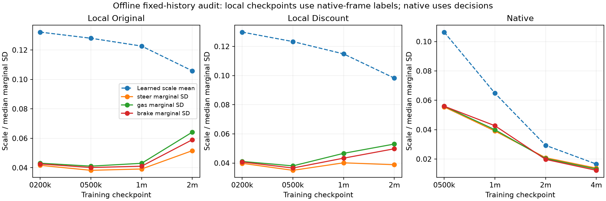

# Offline action-distribution and update audit

Pre-execution declaration, 2026-10-30. [Latest local trial](LOCAL_DISCOUNT_TRIAL_2026-10-29.md)

**Origin:** user requests continuing the paper work; assistant proposes this
diagnostic after native/local training regressions and unsuccessful repair probes.
Purpose: distinguish the logged learned gSDE noise scale from effective control
variance and clipping. High confidence in the measurement value, unknown cause
of observed regression. No cause, performance gain or new training recipe is assumed.

Freeze all four checkpoints from each of three completed families: original local,
local discount, and native. For every checkpoint replay the first five recorded
development episodes twice: once from that checkpoint's own evaluation and once
from a fixed common history within its protocol. Common local histories come from
the original selected local 1M policy; common native histories from native 1M.
Five tracks are a fixed diagnostic panel, not an independent performance estimate.
Replay actor memory from zero through complete histories. Only permitted actor
observations enter inference. Common histories are off-policy conditional inputs:
they do not predict what the inspected actor would actually observe while driving.

Measurements per steering/gas/brake channel:

- Raw Gaussian mean and state-dependent marginal standard deviation, verified
  against the gSDE latent-feature/noise-scale formula in installed SB3.
- Deterministic action clipping frequency and analytic sampled clipping probability.
- Exact clipped-Gaussian expectation/variance and the gap between clipped mode
  and expected clipped action. These are single-history marginal statistics,
  not a new controller or Monte Carlo driving scores.
- Probability of gas and brake both exceeding 0.05 at one history, and overlap
  of deterministic controls. The threshold is a declared diagnostic convention.
- Last 20 logged PPO update summaries near each checkpoint: approximate KL,
  clipped fraction, logged learned noise scale and explained variance. Association
  with actor statistics does not establish a learning mechanism.

Require deterministic clipped means to reproduce every recorded own-history action
within 1e-6; compare the first 16 steps per episode with the standard model.predict
API exactly. Verify analytical marginal moments against independent numerical
quadrature in tests. Replay once per panel, save results and hashes under new IDs.
Policies and their normalizers remain fixed; observation normalization is disabled
in these protocols. No training, scenario selection or environment instantiation.

Budget: 12 checkpoints × two panels × five episodes; at most 60,000 offline
decision replays and 61,920 actor forward examples including API parity checks.
**Zero new environment steps, internal physics steps or optimizer updates.**
No private candidate ranks/oracle regrets, calibration or final-test identities
are read. The [manifest](../configs/campaigns/action-distribution-audit-2026-10-30.json)
pins model and permitted-history artifacts. Do not expand panels or choose a
different checkpoint from these measurements.

gSDE shares sampled noise across time; per-history Gaussian formulas do not
reproduce that temporal correlation or sampled-policy driving. Small learned
noise-scale parameters alone cannot establish exploration collapse. The audit
may motivate one separately declared replay/learning control or an independent-
seed baseline replication. It does not authorize an open-ended repair sweep.

Status: complete. All existing checkpoint and method-selection decisions remain
as recorded in the completed campaigns.

## Completed measurements and decision

All twelve own-history actor replays reproduce saved controls with **zero maximum
error**; all standard-predict API checks match exactly. All 828 frozen source-file
hashes verify. The [public summary](../reports/action_distribution_2026-10-30/summary.json)
contains every own/common panel and the nearby update-log summaries;
[provenance](../reports/action_distribution_2026-10-30/provenance.json) pins raw
measurements and scripts.

| Family / checkpoint | Learned scale mean | Steering marginal SD, median | Gas marginal SD, median | Brake marginal SD, median |
|---|---:|---:|---:|---:|
| Original local 1M | 0.1226 | 0.039 | 0.043 | 0.041 |
| Original local 2M | 0.1058 | 0.052 | 0.064 | 0.059 |
| Discount local 1M | 0.1149 | 0.040 | 0.047 | 0.043 |
| Discount local 2M | 0.0983 | 0.039 | 0.053 | 0.050 |
| Native 1M | 0.0649 | 0.039 | 0.040 | 0.043 |
| Native 2M | 0.0293 | 0.021 | 0.020 | 0.020 |
| Native 4M | 0.0166 | 0.014 | 0.013 | 0.012 |

Table values use the fixed common-history panel within each protocol, pooled by
recorded decision. Local/native panels differ and remain separate conditional
analyses. The learned scale decreases for all families, while effective local
action variation can increase. A single shared exploration-collapse explanation
for the training regressions is therefore unsupported. The median clipped gas SD also increases from 0.0423 to 0.0622 in original local 1M→2M,
while native 1M→4M decreases from 0.0361 to 0.0127. Thus the contrast survives the
action bounds in these histories. Native variation does
shrink substantially, but the observations alone do not show that it caused
regression or how more stochastic driving would perform.

At original local 1M/2M, deterministic brake controls hit the lower bound on
95%/92% of the common histories; predicted sampled brake clipping is 88%/86%.
For native 1M/4M the corresponding rates are 91%/93% and 90%/93%. Steering hardly
clips in this panel. A zero-brake action is valid; these rates alone do not prove
a defect. State-conditioned gas/brake overlap and expected-clipped-action gaps
are in the full table. Temporal noise correlation and closed-loop performance
were not measured. Nearby PPO update logs are descriptive correlates only.

Measured cost: **55,750 offline decision replays, 57,670 actor forward examples,
34.23 seconds**, zero new racing, model-physics steps or optimizer updates. Unit-
test costs are separate. Final-test/calibration/private ranking data stays sealed.

**Assistant decision:** retain both original method-selection decisions and make
no action-distribution/controller change from this audit. The checked replay and
variance calculations identify no implementation fault. Next run the separately
[declared local seed 1/2 replications](LOCAL_REPLICATIONS_2026-10-30.md) to measure
whether the retained recipe's useful early policy and later degradation recur.
Report every seed and checkpoint; these are exploratory 2M-review trials.
