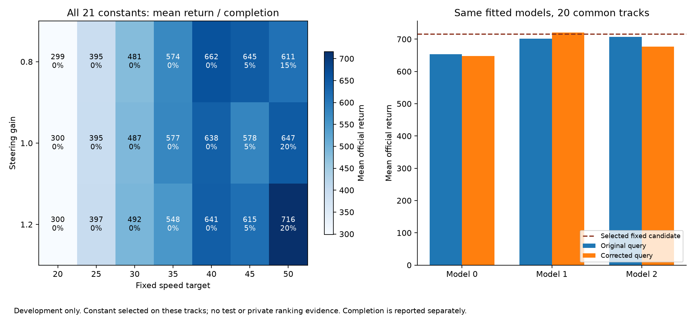

# Control audit: corrected world query and matched fixed candidates

Completed 2026-10-28. [Index](../README.md) · [Original pilot](PILOT_2026-10-28.md) ·
[Execution plan](NEXT_EXPERIMENTS.md) · [User intent](USER_INTENT.md)

The first follow-up batch is complete: 24 conditions, 480 episodes on the same
20 development tracks. The world-query inconsistency is corrected. Search has
not established an advantage over a constant chosen from its own candidate set.
These are adaptive development results; no final test or private ranking output
was accessed. No new research-model training was performed in this batch.

## Change and comparison contract

Previously, unknown cells inside the square raster acted as grass for predicted
dynamics, whereas positions outside the array acted as road. The new shared
road query uses observed occupancy inside the sensor circle and the declared
constant-width continuation outside it. Dynamics grip and planning margins now
query the same hypothesis. Interpolation at visible positions is normalized by
visible-cell weight, avoiding masked-padding grass. The observed distance-based
margin, scoring weights, reconstructed path, horizon, candidate grid and fitted
models remain unchanged. This is a combined semantics correction, not an isolated
study of only one interpolation choice or a change to official physics.

The continuation still approximates distance using sampled path points; grip is
an observed-center contact proxy, not a tire-level physical model. This correction
does not establish that the assumed road or dynamics is accurate.

The [campaign manifest](../configs/campaigns/control-audit-2026-10-28.json) was
written before this batch, informed by the preceding pilot. It fixes model hashes,
20 development tracks, 21 speed/gain constants, comparison/selection rules,
failure thresholds and budget. It is not a confirmatory preregistration.

- Protocol: radius-30 local geometry at 1 m resolution, permitted ego sensors and
  previous action, repeat 4, official reward/physics/termination.
- Search: the same three previously fitted mixed-data ridge models; speeds
  20,25,30,35,40,45,50 × gains 0.8,1.0,1.2; 20 decisions per candidate rollout.
- Constants: every pair from that exact grid, same path reconstruction and
  low-level controls, one fixed pair throughout a campaign.
- Selection: highest mean development return; exact ties use completion and
  candidate order. All 21 outcomes are retained, including low-performing ones.

## Results

| Controller / condition | Mean return | Completion |
|---|---:|---:|
| Original search, three fitted models | 687.0 | 20% each |
| Corrected search, model 0 | 648.3 | 4/20 |
| Corrected search, model 1 | 720.3 | 4/20 |
| Corrected search, model 2 | 677.2 | 4/20 |
| Corrected search, three-model mean | **681.9** | **20% each** |
| Selected fixed candidate: speed 50, gain 1.2 | **716.1** | **4/20** |
| Previous fixed speed 60, gain 1.0 reference | 613.4 | 6/20 |

The selected constant sits at the highest speed and gain in this grid. That
motivates checking the grid boundary; it does not prove that higher values help.

| Exploratory contrast | Mean difference in return | 95% bootstrap interval |
|---|---:|---:|
| Corrected minus original search | −5.1 | [−50.5, +40.0] |
| Corrected search minus selected constant | −34.2 | [−128.0, +57.7] |
| Corrected search minus previous fixed60 | +68.5 | [−7.7, +168.6] |

For the correction, pair identical fitted models before/after, then resample
model pairs and common track columns. For search versus a deterministic constant,
resample the three fitted models and shared track columns. Use 5000 draws. The
constant was selected on these same 20 tracks; these intervals are not adjusted
for that selection or earlier adaptive decisions. Neither equivalence nor a
reliable advantage/disadvantage is established. Completion remains poor even
where return is relatively high.



## What failed, and what that suggests

Across the corrected search's 60 episodes (three models on **20 shared tracks**):

| Outcome | Episodes |
|---|---:|
| Completed | 12 |
| Timed out with some wheel contact on road | 38 |
| Timed out with zero wheel contact on road | 9 |
| Left the playfield | 1 |

Of the 38 on-road timeouts, 23 had zero fully off-road frames during the entire
episode. Their group is evidence that departures alone do not explain low
completion. Across all 38, median final progress was 91.4%, and mean final-two-
second speed was 46.4 m/s. No search episode met the predefined low-tail-speed
threshold of 2 m/s. Cars can still circle, take poor paths or lose time earlier;
these summaries do not prove that speed alone is the cause.

The selected constant had four completions, ten on-road timeouts, five off-road
timeouts and one playfield exit. All constants with speed targets at or below
40 completed zero races in this panel. Higher pace is therefore a priority to
investigate alongside recovery, model and scoring quality. It would be premature
to explain the whole result by missing-road prediction.

Off-road means zero wheel contact, not a collision. Contact at termination is
not equivalent to successful recovery. The last-100-native-frame speed and
progress-below-0.5 flags were specified before analysis and are descriptive.
Exact off-road frame indices are saved only after an episode by the evaluator;
they are never an input to the driving policy. No candidate oracle is involved.

## Cost, validation and reproducibility

- Campaign: **473,737 native frames**, below the declared 480k cap;
  **6,237,000 internal model transitions**; zero new model-training frames.
- Three concurrent CPU evaluation processes: 90.3 seconds campaign elapsed;
  summed per-run elapsed time 269.1 seconds. These are not CPU-time measurements.
- Search sensor-plus-policy p95: 6.89–7.05 ms; fixed constants: 1.31–1.45 ms.
  Latencies were measured under concurrent load and exclude simulator and disk
  work; they are diagnostic, not an isolated hardware performance claim.
- One separately replayed development episode reproduced all actions, rewards,
  permitted observations and termination flags exactly. This used 995 native
  frames and 104,580 model transitions, reported separately from the campaign;
  it is a verification repeat, not an independent replicate.
- **63 tests pass**, including synthetic road queries, frame accounting, information
  isolation, model reload and failure summaries. Figure visually checked.

Small public artifacts are in [the report directory](../reports/control_audit_2026-10-28/analysis.json):
[all fixed choices](../reports/control_audit_2026-10-28/fixed_candidates.csv),
[condition summaries](../reports/control_audit_2026-10-28/summary.csv),
[episode outcomes](../reports/control_audit_2026-10-28/episodes.csv),
[replay check](../reports/control_audit_2026-10-28/replay_check.json), and
[exportable figure](../reports/control_audit_2026-10-28/control_audit.pdf).
Large trajectories, immutable configs, source snapshots and costs remain under
the explicit run paths in the manifest; they are gitignored.

```bash
uv run python scripts/run_control_audit.py --manifest configs/campaigns/control-audit-2026-10-28.json
uv run python scripts/summarize_control_audit.py
```

The first command intentionally refuses to overwrite this completed campaign.
For an independent rerun, copy the manifest with a new campaign ID and new run
IDs; preserve model hashes and comparison settings. The second command rebuilds
the public analysis from explicitly listed runs and never traverses private data.

## Decision and next budget

Retain the corrected semantics, restricted information interface, partitions,
provenance and the selected constant as a reference. Do not present the correction
as a performance improvement or the current search as a successful method.

The user's broader idea remains the main project. The ridge dynamics, forward-row
path reconstruction, straight-road prior and fixed candidate family can all be
replaced. This batch diagnoses one implementation, not the value of every possible
world model or simulation-based controller. Predictor-space selection, borrowed
models, multiple road hypotheses, continuous/adaptive search, expert variants and
future evolution retain their documented intent and access constraints.

**Proposed next diagnostic batch: at most 60k native evaluation frames, no new
model training.** This is an evidence-driven amendment to the original 40k
full-map-only proposal, recorded after the present batch:

1. Hold gain at 1.2 and test local fixed speed 60 against the already measured
   speed-50 constant: one condition × 20 tracks, at most 20k frames. This checks
   pace without simultaneously changing steering gain or fitting a new model.
2. Implement the declared same-planner full-map diagnostic and fixed50/gain1.2
   reference: two conditions × 20 tracks, at most 40k frames. Use fitted model 0
   and the original bounded grid; report any representation change explicitly.
3. Review pace and information evidence before revising candidate coverage,
   dynamics, objective or prediction representation. The full-map experiment
   uses ordinary episode outcomes and does not recreate private ranking feedback.

In parallel preparation, the [recurrent baseline audit](BASELINE_AUDIT.md) now
records concrete adapter gaps, checkpoint/schedule requirements and the distinction
between a matched local adaptation and an upstream pixel-recipe reproduction.
The next learning gate remains a declared one-seed 200k-native-frame run once
those prerequisites are implemented. Neither that training nor the proposed
60k-frame diagnostic batch has started. Final test remains sealed.
