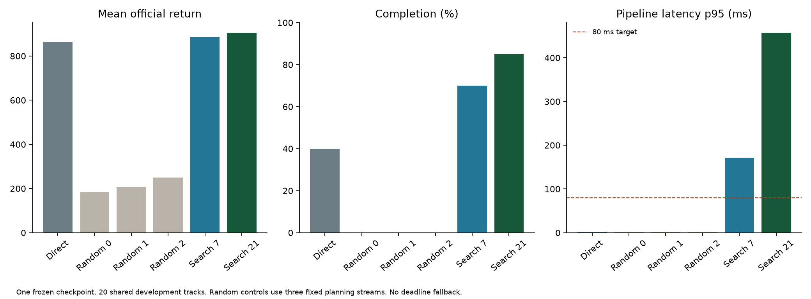

# Frozen-policy simulation search: development results and follow-up controls

2026-10-28. [Index](../README.md) · [Specification](EXPERIMENT.md) ·
[Next moves](NEXT_MOVES.md) · [Previous geometry/training results](GEOMETRY_AND_DRIVER_2026-10-28.md)

All campaigns described here are complete. No training or racing process remains
running from this batch. Final-test/legacy held-out data and private candidate
rank/regret outputs were not opened. The full suite passes **79 tests**.

## Main finding and its scope

Programmed simulation selection improved this frozen local-policy instance on
the 20-track development panel. The 21-candidate condition increased official
mean return from **863.55 to 905.94** and completion from **40% to 85%**. This is a
positive engineering result, not a general algorithm, SOTA or native-pixel claim.

The proposer is the original standalone-selected 1,007,379-frame recurrent-PPO
checkpoint, SHA-256 `9475b51cb882f0afcd73f9b9cf66643860a3a989d6a67918bce3198ad4f7d741`.
Its reported 858.11/30% in the previous report used 50 development tracks. The
863.55/40% here uses their first 20; the weights are identical. Selection used
standalone performance, before measuring search benefits.

The [declaration](../configs/campaigns/frozen-driver-2026-10-28.json) fixes local
30 m geometry, ego sensors, history, repeat four, the programmed mechanics,
20-decision/1.6 s planning horizon, straight unknown-road continuation and existing
coded utility. Each candidate follows the same frozen feedback policy with three
smooth residual knots. Candidate zero has no residual. Imagined recurrent memory
is independent and never committed to real policy history. Search receives no
evaluation-world clone, hidden road, wheel truth or private candidate outcomes.

| Condition | Mean return | Completion | Mean off-road frames | Pipeline p95 |
|---|---:|---:|---:|---:|
| Direct frozen policy | 863.55 | 40% | 23.70 | 1.50 ms |
| Random 7, stream 0 | 183.10 | 0% | 3.60 | 1.59 ms |
| Random 7, stream 1 | 205.65 | 0% | 5.65 | 1.59 ms |
| Random 7, stream 2 | 250.52 | 0% | 3.55 | 1.62 ms |
| Simulation selection, 7 | 885.70 | 70% | 1.90 | 171.60 ms |
| Simulation selection, 21 | 905.94 | 85% | 0.40 | 457.48 ms |

Paired common-track bootstrap intervals (5,000 draws, seed zero):

- Seven minus direct: return **+22.15 [−3.14, +47.94]**; completion +30 percentage
  points [10, 50]. Its return interval includes zero.
- Twenty-one minus direct: return **+42.39 [+14.36, +75.60]**; completion +45
  percentage points [25, 65].
- Twenty-one minus seven: return +20.24 [7.63, 37.08].

These are exploratory, unadjusted intervals over repeatedly used development
tracks. They condition on one selected checkpoint and fixed planning streams;
they do not include training-seed variation, planner-seed population uncertainty,
development selection or multiplicity. No final test has occurred.

The random control is specifically variation without outcome-based selection.
It is weak: mean brake commands were 0.051–0.065 versus 0.0056 for direct control,
and mean forward speed was 14–17 versus 56. Symmetric residuals clipped at zero
can create a positive braking bias. These measured actions support a slow-driving
explanation, but do not independently establish causality. Beating this control
alone would not establish useful planning; the direct-policy contrast matters.

Search overrode the base first action on 56.0% and 93.1% of decisions for 7 and
21 candidates. This is intervention frequency, not the fraction of individually
correct overrides. No privileged counterfactual ranks were inspected. Search's
coded score is not the exact official reward, and one assumed road is not a
calibrated distribution over hidden geometry.

## Cheap constant-correction controls

**Assistant probe:** could the improvement be explained by a fixed correction to
the base policy, avoiding expensive online simulation? The
[follow-up declaration](../configs/campaigns/fixed-bias-2026-10-28.json) specifies
three controls before their evaluation. For each search size, average executed
action minus its same-observation base action within each race, then equally across
the 20 races. Add that constant three-component offset to the frozen driver and
clip to the official bounds. A third control uses only the 21-candidate gas offset.

These offsets are fitted from ordinary public development traces, not private
oracle values. Fitting and evaluation share this panel, so they are adaptive
diagnostics. They are not new trained policies or established external baselines.

| Fixed correction | Steering / gas / brake offset | Mean return | Completion |
|---|---|---:|---:|
| Mean correction from search 7 | −0.02033 / +0.03557 / +0.00623 | 860.45 | 60% |
| Mean correction from search 21 | −0.03712 / +0.07583 / +0.00520 | 763.67 | 10% |
| Gas-only correction from search 21 | 0 / +0.07583 / 0 | 738.93 | 5% |

All cost about 1.5 ms p95. The best-return correction improves completion over
direct control without improving mean return. Search 21 minus that correction
is +45.49 return, exploratory paired interval [5.70, 111.15]. These particular
constant offsets do not recover the full search gain. This does not rule out
better cheap heuristics, a learned direct scorer or established planning methods.

## Runtime diagnosis and equivalent renderer

An instrumented profile on three cached training-partition snapshots identified
imagined-observation construction as the largest sampled cost. The policy needs
binary road occupancy; the reference implementation also computes signed margins
and nearest-center distances that are unnecessary for many sensor points.

`planning/occupancy.py` now offers a sparse query path with the same occupancy
semantics. It preserves the coordinate transform, bilinear observed occupancy,
visibility normalization and constant-width sampled-path prior. It queries prior
distances only where needed, with boundary handling and a subclass fallback.
The original renderer remains the default; `--observation-renderer sparse` is an
explicit implementation option, not a new prediction method or control objective.

Verification includes randomized positions, visibility holes, exact width/circle
boundaries, identical imagined observations, identical sampled candidate action
sequences/costs, and two complete recorded race replays (one per budget). Both
replays reproduced all real actions, rewards, observations, selected candidates
and predicted chosen costs exactly. This is sampled equivalence evidence, not a
proof for every possible floating-point input.

Three alternating-order snapshot measurements gave median policy times of:

| Candidates | Reference | Sparse | Reduction |
|---|---:|---:|---:|
| 7 | 154.4 ms | 108.2 ms | about 30% |
| 21 | 428.9 ms | 276.8 ms | about 35% |

These are contended snapshot timings, not race latency quantiles. Full replay
p95 policy-only times were 132.7/357.9 ms on the two replayed races. Do not replace
the original campaign's latency numbers with these values. Both implementations
still exceed the 80 ms target; no deadline fallback or real-time claim exists.

## Baseline-repair trial: retain the negative result

The original PPO run regressed after 1M. A separately declared fresh seed-zero
trial changed only the algorithm parameter `target_kl` from none to 0.02, keeping
the architecture, optimizer settings, native-frame budget and global 8M schedule.
See the [manifest](../configs/campaigns/driver-kl002-block-2026-10-28.json).

The [upstream API](https://sb3-contrib.readthedocs.io/en/master/modules/ppo_recurrent.html)
provides KL-based early stopping. The installed source stops remaining training
when a minibatch's approximate KL exceeds 1.5 times the target. This is not a hard
divergence guarantee, and stops actor and critic optimization together.

| Actual training frames | Mean return on 50 tracks | Completion |
|---|---:|---:|
| 204,789 | 355.27 | 0% |
| 507,883 — trial-selected | 697.04 | 4% |
| 1,007,567 | 497.33 | 0% |
| 2,006,884 | 570.17 | 0% |

**Decision:** do not adopt or extend this setting. Retain the original 1M proposer.
The new trial made 2,983 optimizer steps versus 39,200 in the original block;
205/245 rollout updates stopped within their first epoch. All diagnostics were
finite. Less aggressive policy change did not produce a stronger driver here,
and the substantial reduction in optimization is part of the intervention.
This one trial neither establishes the cause of the original regression nor
shows that KL stopping is universally harmful. Baseline repair remains open.

## Costs, verification and reproduction

| Completed work | New training native frames | Evaluation/check native frames | Internal physics frames |
|---|---:|---:|---:|
| Six-condition search comparison | 0 | 113,726 | 9,713,200 |
| Three fixed-correction controls | 0 | 56,896 | 0 |
| KL trial and four checkpoint evaluations | 2,006,884 | 195,829 | 0 |
| KL trial reload check | 0 | 8 | 0 |
| Source/trace audit, short replay and instrumented profile | 0 | 96 | 33,600 |
| Renderer parity/timing and full replay | 0 | 1,580 | 446,880 |

The original policy training, hardware profiling and checkpoint-selection costs
remain additional in the previous report. The main six-condition campaign took
2,617.7 s and used 2,335,331 actor forward examples. The KL campaign took 445.0 s;
its training cost was 414.7 s and was lower partly because of fewer optimizer
steps. Do not claim equal compute from equal data frames. Zero-bias verification
used 240 cached-observation actor evaluations and no environment frames.

All six original conditions have identical source hashes and checkpoint identity.
Public trace rewards, frame/work counts and actions passed consistency checks.
The earlier direct-policy replay also exactly reproduced its screening traces.
All attempts, including poor controls and the failed repair hypothesis, remain.

Public artifacts:

- [Main summary](../reports/frozen_driver_2026-10-28/summary.csv),
  [paired analysis](../reports/frozen_driver_2026-10-28/analysis.json),
  [audit/profile](../reports/frozen_driver_2026-10-28/audit.json),
  [renderer verification](../reports/frozen_driver_2026-10-28/renderer_verification.json).
- [Fixed-correction results](../reports/fixed_bias_2026-10-28/summary.csv) and
  [analysis](../reports/fixed_bias_2026-10-28/analysis.json).
- [KL checkpoints](../reports/driver_kl002_block_2026-10-28/checkpoints.csv),
  [training costs/provenance](../reports/driver_kl002_block_2026-10-28/analysis.json),
  [review](../reports/driver_kl002_block_2026-10-28/review.json).

Rebuild summaries with `uv run python scripts/summarize_frozen_driver.py` and
`uv run python scripts/summarize_driver_block.py --campaign runs/campaigns/driver_kl002_block_20261028 --output reports/driver_kl002_block_2026-10-28`.
Campaign runners and verification scripts use immutable IDs; do not rerun them
over completed directories. Their declarations and executed source snapshots
remain under `configs/campaigns/` and the corresponding `runs/` directories.

## Decision after this batch

Preserve the promising original-checkpoint search result and the cheap-control
caveat. Broaden the frozen comparison to all 200 development tracks with a declared
budget before further planner tuning; report the original 20 as a nested subset.
Include direct, search 7/21 and the best-return fixed correction. Then compare an
audited iCEM-style optimizer at matched total simulator work before algorithmic
superiority claims. A subsequent lower-learning-rate PPO probe retaining ten
epochs is more informative than another undeclared KL sweep. It is not launched.
Multi-seed and native-input evidence remain required for stronger paper claims.
