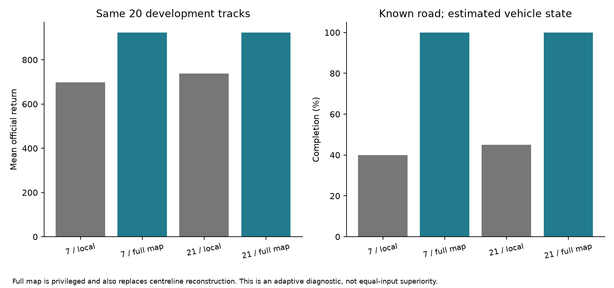
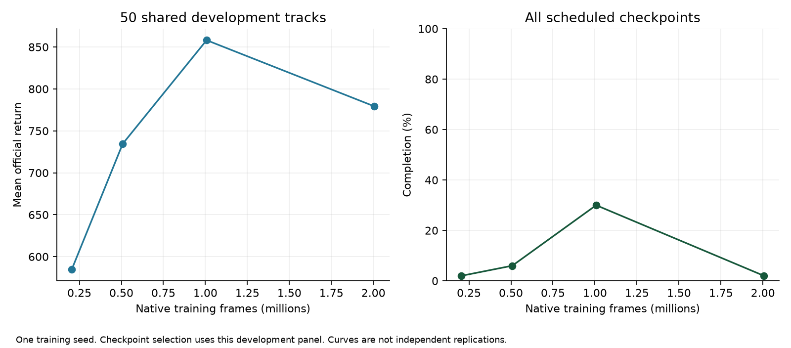

# Geometry diagnostic and first learned-driver results

2026-10-28. [Index](../README.md) · [Next moves](NEXT_MOVES.md) ·
[Previous results](PROGRAMMED_SIMULATOR_RESULTS.md)

**Follow-up complete:** the six-condition frozen-policy comparison, fixed-correction
controls, renderer verification and a negative KL training trial are reported in
[FROZEN_POLICY_RESULTS_2026-10-28.md](FROZEN_POLICY_RESULTS_2026-10-28.md).
The sections below preserve the preceding geometry/first-driver evidence.

## Completed geometry diagnostic

The same programmed-physics search now has an explicitly privileged full-map
variant. It receives road boundaries and an ordered centerline in car coordinates,
plus the same ego sensors and previous action. It retains the same estimated
wheel state, five-point contact approximation, utility coefficients, 1.6 s horizon
and four-frame execution. No true wheel or solver state is passed to the planner.

The original local raster query is preserved inside its sensor circle. Outside,
the diagnostic uses a rasterized known map instead of a straight continuation.
The control path also changes from local row reconstruction to a uniformly sampled
ordered true centerline. Unknown-space penalties naturally vanish where the map
is known. Therefore this tests **geometry access plus reconstruction**, not only
hidden-road prediction. Full-map direction/topology is privileged information.

The [manifest](../configs/campaigns/geometry-diagnostic-2026-10-28.json) was saved
before execution: wider 7/21 candidates on the same 20 development tracks, capped
at 40k native frames and 11.2M internal physics frames. A separate 80-native-frame
local replay check reproduced all actions, rewards, observations and endings
exactly after the shared search refactor.

| Configuration | Mean return | Completion | Off-road frames, mean | Decision latency p95 |
|---|---:|---:|---:|---:|
| Local geometry, 7 candidates | 697.8 | 40% | 123.9 | 48.9 ms |
| Full map, 7 candidates | 923.15 | 100% | 0 | 79.8 ms |
| Local geometry, 21 candidates | 737.3 | 45% | 110.8 | 128.5 ms |
| Full map, 21 candidates | 923.60 | 100% | 0 | 169.6 ms |

All 40 new full-map episodes completed. These are two conditions on 20 shared
tracks, not 40 independent tracks. Full-map minus local return differences have
exploratory paired 95% bootstrap intervals: seven candidates +225.4 [116.4, 348.6];
21 candidates +186.3 [92.8, 288.4]. They are not adjusted for earlier development
selection. Neither comparison establishes standard-input superiority or SOTA.



**Interpretation:** geometry/reconstruction is an important bottleneck for this
planner. Its coded dynamics, estimated vehicle state and candidate controllers
can support competent driving with better geometry. The experiment does not
separate visible reconstruction from unseen continuation or prove that search is
necessary under full-map access; a matched fixed full-map controller was not run.
It also does not make the full-map score a mathematical upper bound.

The next local geometry work should distinguish reconstruction quality from
unseen-road uncertainty before training a complicated forecast. This does not
replace the planned stronger-proposer comparison. The latter tests whether
simulation selection helps a policy that already learns useful local behavior.

New geometry cost: **30,651 native evaluation frames**, **8,584,800 internal
physics frames**, zero training. Local replay added 80 native / 11,200 internal
frames separately. The campaign took 602.7 s wall time with the two runs sharing
the workstation. The seven-candidate full-map run still missed the 80 ms deadline
on an episode-mean 4.47% of decisions; p95 near 80 ms is not a hard real-time claim.

## Implemented training pipeline

The new `research train-driver` path is a declared recurrent-PPO local adaptation
of the pinned RL Zoo recipe, separate from the older engineering trainer. It adds:

- A resolved configuration, including network, exploration, normalization,
  worker/device settings, decision discount and training budget.
- Learning-only reward normalization; evaluation uses original rewards and fixed
  input scaling, with no normalization updates from development observations.
- A learning-rate clock tied to cumulative actual native frames over an 8M global
  horizon. Scheduled checkpoints do not restart this clock.
- Post-optimizer checkpoints with weights, optimizer, normalizer, RNG, training
  sampler and schedule state. Continuation starts fresh episodes and recurrent
  memory; it is not an exact mid-episode Box2D resume.
- Learning diagnostics, scheduled model selection by standalone driving and
  recurrent reload verification. Training never consumes candidate-oracle data.

Profiling initially exposed unsupported deterministic CUDA backward propagation
through adaptive-average pooling. Those three failed profiles are preserved.
The new driver encoder uses an equivalent deterministic pooling implementation;
CPU/CUDA values and gradients were checked against the original operation. The
legacy encoder and legacy checkpoint implementation remain available unchanged.

The corrected one-update profiles measured about 1,457 native frames/s for CPU
with four workers, 776 for CUDA/four workers and 766 for CUDA/eight workers. The
earlier CPU/eight-worker profile offered no clear gain. We selected CPU/four
workers and one Torch thread before starting the main run. These are cold,
single-update profiles, not steady-state throughput guarantees.

Both profiling rounds together used **90,112 training frames**, including failed
attempts, within the declared 100k cap; reload checks added 48 frames. Profile
training uses a separate seed and is not part of the main policy's training.
The original and corrective declarations are
[here](../configs/campaigns/driver-profile-2026-10-28.json) and
[here](../configs/campaigns/driver-profile-poolfix-2026-10-28.json).

## First learned-driver block — complete, regression at 2M

The [training configuration](../configs/training/recurrent-local-v2-s0.json) and
[campaign declaration](../configs/campaigns/driver-first-block-2026-10-28.json)
were saved before training. Seed zero uses the training partition, with an initial
2M-native-frame stop and a fixed 8M-frame global learning-rate horizon. Four
checkpoints are evaluated on the same first 50 development tracks. Selection is
highest standalone mean return, then completion, then earlier checkpoint.

The completed campaign is `runs/campaigns/driver_first_block_20261028/`. All four
post-update checkpoints were evaluated on the same 50 development tracks:

| Actual training frames | Mean return | Completion | Mean off-road frames |
|---|---:|---:|---:|
| 204,800 | 584.86 | 2% | 206.80 |
| 507,856 | 734.57 | 6% | 186.24 |
| **1,007,379 — selected** | **858.11** | **30%** | **31.08** |
| 2,006,414 | 779.22 | 2% | 139.28 |



The declared standalone selection rule keeps the **1M checkpoint**, SHA-256
`9475b51cb882f0afcd73f9b9cf66643860a3a989d6a67918bce3198ad4f7d741`.
It has useful driving behavior but remains an incomplete one-seed development
baseline. It is not a converged or externally competitive comparator.

The block used **2,006,414 training native frames**, including 6,414 frames of
complete-rollout overshoot, plus **196,576 development evaluation frames** and
eight reload-check frames. Training took 1,516.8 s (1,322.8 native frames/s), with
checkpoint evaluation contention included; the campaign took 1,545.1 s. There
were 245 rollout/update cycles and 2,450 PPO training epochs, not 2,450 independent
rollout updates. All saved diagnostics and model parameters were finite.

**Health-review decision (assistant):** do not extend this recipe unchanged to
8M now. Preserve the selected checkpoint and proceed with the bounded exploratory
search comparison. Off-road time rose from 31.08 to 139.28 frames per race by 2M.
Later updates also had larger approximate KL (median 0.068 after the selected
checkpoint versus 0.032 in the preceding phase) and more clipping. These are
possible optimization symptoms, not proof of causality. A separately declared
conservative-update trial, such as a target-KL cap, is a future repair probe;
no training configuration has been silently changed or resumed.

The primary evidence is the [checkpoint table](../reports/driver_first_block_2026-10-28/checkpoints.csv),
[cost/provenance report](../reports/driver_first_block_2026-10-28/analysis.json), and
[health review](../reports/driver_first_block_2026-10-28/health_review.json).

## Frozen-policy search integration — pre-race verification

`planning/policy_search.py` proposes three-knot smooth residuals around a frozen
recurrent policy's feedback behavior. Candidate zero is the unchanged policy.
It simulates the same programmed mechanics and scores the same coded utility.
Future policy inputs are local observations rendered from the hypothesized road,
not the actual evaluation world. Each imagined branch owns its recurrent state;
real policy memory is advanced only by actual observations. A random-selection
control uses the same proposal bank without simulation and a separate random stream.

Tests verify original-action equivalence for a one-candidate search over multiple
real observations, isolation of imagined recurrent history, deterministic reset,
matching random/search proposal banks, action bounds and sensor-field isolation.
The full suite passed **76 tests**, with three upstream SWIG warnings.

A small preflight used the 500k checkpoint only for integration/timing, on a
training-partition track. It cost 320 native and 6,720 internal physics frames.
Three history-reset snapshots took 172–189 ms for seven candidates and 478–523 ms
for 21. Training and unit tests overlapped this check; these are contended
snapshot timings, not isolated latency quantiles or racing evidence. Simulated
observations and repeated neural inference add substantial cost; do not reuse
the earlier fixed-controller timing claims for the learned-policy wrapper.

After selection, an additional train-only preflight used the frozen 1M checkpoint
with no project training/evaluation running. Its three snapshots took 148–161 ms
for seven candidates and 401–436 ms for 21, costing another 320 native and 6,720
internal frames. Ordinary system load is uncontrolled. These few samples are not
latency quantiles; both budgets already exceed the 80 ms target.

## Frozen-checkpoint racing comparison — completed follow-up

The [six-condition manifest](../configs/campaigns/frozen-driver-2026-10-28.json)
was saved before racing. It freezes the selected 1M weights, local protocol,
1.6 s horizon, existing utility and straight-road continuation. It compares the
direct policy, random selection with three fixed planning streams, and simulation
selection with 7/21 candidates on the first 20 development tracks. These tracks
are a subset of the checkpoint-selection panel; the comparison is exploratory.

The cap is 120k native evaluation frames and 11.2M internal physics frames, with
zero new training. Conditions run sequentially, with one Torch thread. The two
search sizes share a candidate prefix at a given decision counter; diverging
closed-loop observations subsequently produce different feedback actions. Random
streams reset each episode and are shared across tracks, not independent model
replications. Report all three controls; the mean-random contrast has only
conditional track uncertainty, not an estimated population of planning seeds.

Run state is `runs/campaigns/frozen_driver_20261028/status.json`; the runner writes
each condition's immutable artifacts and automatically summarizes all six once
complete. It is now complete: direct 863.55/40%, seven-candidate search 885.70/70%,
and 21-candidate search 905.94/85% on the same 20 tracks. Full controls, uncertainty,
costs and follow-ups are in the linked report. This run measures unrestricted
offline driving quality, with no deadline fallback. It cannot establish a gain
over a final strong/SOTA policy.
The direct condition exactly reproduced all 20 earlier checkpoint-screening
traces: actions, rewards, frame counts, endings and all allowed observations
(180 array checks, no additional environment frames). Verification is recorded
at `runs/verification/frozen_driver_direct_replay_20261028/result.json`.

## Reproduction and artifacts

```bash
uv run python scripts/summarize_geometry_diagnostic.py
uv run python scripts/summarize_driver_block.py
uv run python scripts/summarize_driver_health.py
# After all six frozen-driver evaluations complete:
uv run python scripts/summarize_frozen_driver.py
uv run python -m cars.cli research train-driver --help
uv run python -m cars.cli research evaluate --help
```

Completed run IDs are immutable. The campaign runners reject overwrites.
Public geometry artifacts: [summary](../reports/geometry_diagnostic_2026-10-28/summary.csv),
[analysis and provenance](../reports/geometry_diagnostic_2026-10-28/analysis.json),
[outcomes](../reports/geometry_diagnostic_2026-10-28/outcomes.csv),
[exportable figure](../reports/geometry_diagnostic_2026-10-28/geometry_diagnostic.pdf).
Training and preflight artifacts retain their configs/source snapshots under
`runs/driver_training/` and `runs/verification/policy_search_preflight_20261028/`.
The isolated selected-checkpoint preflight is
`runs/verification/policy_search_selected_preflight_20261028/`.
Final-test/legacy held-out data and the user's private ranking outputs remain sealed.
