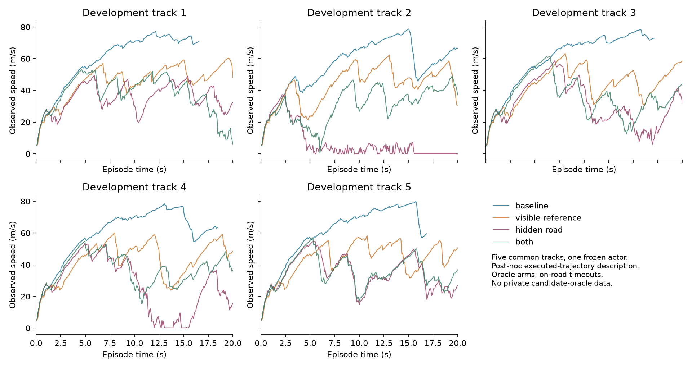

# First controlled geometry interventions: a negative driving result

2026-10-29. [Protocol](INTERVENTION_STUDY.md) · [Blueprint](PAPER_BLUEPRINT.md) ·
[Status](STATUS.md) · [Index](../README.md)

**All four conditions finished.** This is a five-track development integration
pilot around one frozen recurrent policy, not the full V/L/F training study.
The user's decomposition question motivated the work. The assistant chose the
independent switches, pilot budget and subsequent executed-action audit.

## What changed and what stayed fixed

The first switch supplies the true directed centreline inside the visible circle
as the objective reference, followed by the existing tangent extension. The
second replaces road occupancy/margins outside that circle with oracle-derived
geometry. All cells keep the same local actor inputs/history, checkpoint, seven
candidates, 20-decision horizon, repeat four, programmed vehicle/observer,
residual generator, weights and outside-footprint penalty.

The road prior and objective reference are independent: changing the latter does
not alter tire contact or imagined observations. Supplying a visible centreline
adds privileged topology/direction labels; this is not a visual-perception test.
Oracle road is rasterized and does not supply true wheels or solver state.

The baseline reproduced all five earlier search-7 episodes **exactly** in
observations, actions, rewards, termination and departures. Positive/negative
unit controls and actor input/memory checks passed. All declared/actual protocols,
checkpoints, source hashes and dependencies match. No reference fallback occurred.

## Complete pilot results

| Geometry intervention | Mean official return | Completed | Mean progress | Mean off-road frames | Pipeline p95 |
|---|---:|---:|---:|---:|---:|
| Neither: baseline search | 906.99 | 4/5 | 99.59% | 0.8 | 135.59 ms |
| Visible reference only | 758.96 | 0/5 | 85.90% | 0.0 | 133.70 ms |
| Hidden road only | 429.64 | 0/5 | 52.96% | 0.0 | 212.04 ms |
| Both | 594.21 | 0/5 | 69.42% | 0.0 | 209.13 ms |

All 15 oracle-condition episodes timed out on road; none exited the playfield.
Baseline had four completions and one on-road timeout. All search decisions
exceeded the 80 ms action interval; the environment waits and no deadline fallback
was used. These results do not establish safety or real-time operation.

The visible-reference effect changes sign: **−148.03** return with the original
road prior versus **+164.57** with oracle road. Hidden-road effects are −477.36
with reconstructed reference and −164.75 with oracle-visible reference. The
descriptive interaction is **+312.60** return. Every per-track contrast is retained.
Five repeatedly used development tracks and one actor cannot establish statistical
significance, equivalence, population effects, or a unique additive error split.

## Post-hoc executed-trajectory audit

After the negative outcome, the assistant inspected only recorded executed
actions, observed ego signals and public episode metrics. No new races, private
candidate rankings, oracle returns or regrets were used. Speed estimates use
decision-end observations weighted by action duration, then equal episode weights;
they are not exact integrals of speed over native physics frames.

| Condition | Sampled mean speed | Mean brake command | Mean speed in final 2 seconds |
|---|---:|---:|---:|
| Baseline | 58.80 m/s | 0.0083 | 68.18 m/s |
| Visible reference | 43.37 m/s | 0.0211 | 51.72 m/s |
| Hidden road | 26.90 m/s | 0.0538 | 21.87 m/s |
| Both | 35.21 m/s | 0.0294 | 32.96 m/s |

This confirms lost pace in these episodes. It does not identify which change
caused the braking, distinguish all possible progress inefficiencies, or prove
that the same policy could safely sustain a higher speed.

## Follow-up: predict the same actually executed controls

A separate [bounded declaration](../configs/campaigns/intervention-prediction-audit-2026-10-29.json)
was saved after the pilot and before this audit. Use baseline trajectories only,
all five tracks, roots at decisions 50/100/150 and horizons 1/5/10/20. Replay the
actual prefix to reconstruct estimated wheel state; copy the identical estimate
into both models. Apply the same recorded future controls to each road model,
then compare ego predictions with actual recorded observations. Discard every
forecast state instead of feeding it into the prefix observer. This is prediction
of executed behavior, not evaluation/ranking of alternative candidate actions.

| Horizon | Time | Prior-road velocity-vector RMSE | Oracle-road velocity-vector RMSE |
|---|---:|---:|---:|
| 1 decision | 0.08 s | 0.02589 m/s | 0.02589 m/s |
| 5 decisions | 0.40 s | 0.00696 m/s | 0.00696 m/s |
| 10 decisions | 0.80 s | 6.48078 m/s | 0.00616 m/s |
| 20 decisions | 1.60 s | 31.34888 m/s | 0.00536 m/s |

Each entry pools 15 fixed windows from five tracks; windows are not independent
training runs. At 1.6 seconds yaw-rate RMSE is 1.98878 versus 0.000067 rad/s.
One-decision predictions are exactly identical at every root. The much smaller
oracle errors are consistent with missing road geometry causing long-rollout
errors on these particular executed trajectories. They do not validate contact
or observer accuracy for all search-generated, off-road or perturbed behaviors.
These exceptionally small oracle errors are not a global model-fidelity claim.

## Interpretation and next decision

**Measured:** oracle-derived geometry improved long-horizon prediction of these
recorded controls but worsened closed-loop search driving. The visible-reference
effect depends strongly on the road model. The driving failures were on-road
timeouts with lower sampled speed and more braking, not extra road departures.

**Assistant hypotheses, not established causes:** the current progress/reference
objective, horizon, imagined policy behavior or unmeasured candidate-state errors
may be incompatible with the new road model. In particular, even the `both` cell
still extrapolates the objective reference by a straight tangent beyond the visible
centreline, while the road world can contain real curves. Holding one objective
fixed helps identify a module substitution's effect, but does not make that
objective appropriate for every substituted module.

This is a concrete reason to validate interventions before expensive training.
Do not use this pilot to conclude that perception/forecasting is solved, information
is harmful, an inaccurate simulator is universally preferable, or RL cannot decide.
The result is compatible with the user's emphasis on driving usefulness rather
than fidelity alone; that principle has established prior art and is not a new
novelty claim arising from five tracks.

**Next priority:** an explicitly declared full-road objective-reference control
with the same oracle road model, followed by objective/horizon and imagined-input
checks if needed. That control adds future reference/topology information and
must be labeled as such; it cannot be silently folded into the current two-factor
results. It is proposed, not implemented or run in this batch. The eventual
oracle-input policies must be trained for their interfaces, with strong-baseline
and distribution-shift checks, before interpreting a learned V/L/F matrix.
Do not automatically expand the current failed configuration to 200 tracks or
start a large oracle-training sweep. The original selected actor/search results
remain unchanged. No test data or private monitor results were consulted.

## Cost, artifacts and verification

- Pilot: **19,447** native evaluation frames, **2,723,840** internal native physics
  steps, **651,776** actor-forward examples, **806.27 s** campaign wall time.
- Prediction audit: **5,400** additional internal native physics steps (3,000
  prefix observer + 2,400 forecast), **zero** new environment frames.
- Total new research work: **19,447** real frames and **2,729,240** internal steps;
  zero new policy/model training. Disposable test-fixture training is separate.
- Both declared caps passed. Full regression suite: **84 tests passed**, three
  upstream SWIG warnings. Pytest discovery was fixed to exclude archived snapshots.
- Source was frozen before the four driving conditions. Post-hoc audits have
  explicit provenance and script hashes. The scientific figure was visually checked.

Artifacts: [main summary](../reports/intervention_pilot_2026-10-29/summary.csv),
[every episode](../reports/intervention_pilot_2026-10-29/episodes.csv),
[paired contrasts/provenance](../reports/intervention_pilot_2026-10-29/analysis.json),
[trajectory audit](../reports/intervention_pilot_2026-10-29/trajectory_audit.json),
[prediction windows](../reports/intervention_prediction_audit_2026-10-29/windows.csv),
[prediction summary](../reports/intervention_prediction_audit_2026-10-29/summary.csv),
[prediction costs](../reports/intervention_prediction_audit_2026-10-29/result.json).

All jobs in this batch are complete. Run directories are immutable; reproduce
with new IDs and frozen source rather than overwriting completed artifacts.
