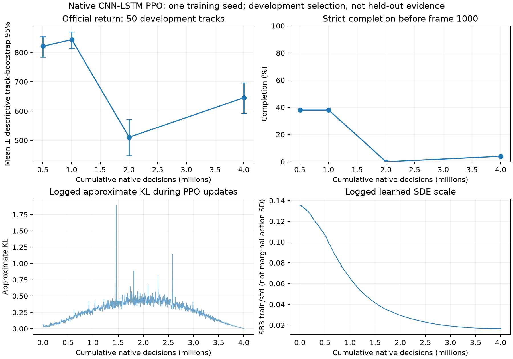

# Native baseline completed: early driving competence, later regression

[Declaration](NATIVE_BASELINE_2026-10-29.md) · [Status](STATUS.md) ·
[Machine-readable audit](../reports/native_baseline_2026-10-29/summary.json)

**Result:** the fixed one-seed native CNN-LSTM campaign completed all four stages
and 200 scheduled development episodes in **2.42 hours**. The predeclared rule
selects the 1M checkpoint: **843.82 mean official return, 19/50 completions**.
The final 4M checkpoint scored **645.80, 2/50 completions**. More training did not
produce a better selected driver in this run. This is an implemented native
recipe adaptation under recorded versions/partitions, not an established SOTA or
converged strong-baseline result.

## Fixed-panel results

All rows use the same first 50 development tracks, native resize64/grayscale/stack2,
one action per native frame, deterministic CPU inference and original reward.
Training uses CUDA/eight subprocess environments. Native pixel scores are not
pooled with the local 30 m mask/repeat-four simulation-search table.

| Requested checkpoint | Actual decisions | Mean return | Descriptive track-bootstrap 95% | Completed | Crashes | Mean progress |
|---|---:|---:|---|---:|---:|---:|
| 0.5M | 503,808 | 821.40 | [784.45, 853.97] | 19/50 | 0/50 | 91.65% |
| **1M, selected** | **1,003,520** | **843.82** | **[813.39, 869.86]** | **19/50** | **0/50** | **94.01%** |
| 2M | 2,002,944 | 510.85 | [448.37, 572.02] | 0/50 | 18/50 | 63.61% |
| 4M | 4,001,792 | 645.80 | [591.99, 696.63] | 2/50 | 0/50 | 74.53% |

The paired 2M-minus-1M return change is −332.96 [−394.46, −272.75]. The 4M-minus-2M
change is +134.95 [71.35, 199.01], so the final policy partially recovers but remains
198.01 below the selected checkpoint. These intervals resample tracks (10,000
paired draws, seed 20261029). They do not represent variation across training seeds,
correct selection bias, or turn this repeatedly used development panel into a test set.

## Integrity and cost audit

The analysis checked all 200 episode traces: observation type/shape, initial stack
clearing, consecutive-frame continuity, terminal history, action bounds and reward
sums. Largest discrepancy between float32 trace rewards and float64 official
cumulative reward: **0.00003228**. It verified 544 source-file hashes across the
eight training/evaluation artifacts; all frozen source snapshots are identical.
The selected checkpoint follows the original return/completion/earlier-step rule.

Each resumed stage starts with exactly the previous stage's saved parameter hash.
Optimizer-step and epoch counters, cumulative learning-rate clock, normalization
counts and training-stream histories are consistent. The 4,168 recorded training
reset identities are unique and disjoint from development. Normalization stays
frozen during evaluation. This is a strong accounting check, not proof that every
implementation choice is ideal. Segmented resumes still restart episodes and
memory; uninterrupted-training equivalence was never claimed.

| Cost | Measured |
|---|---:|
| Native training frames / learner decisions | 4,001,792 |
| Completed rollout updates | 977 |
| Entered PPO epochs | 9,770 |
| Optimizer minibatch steps | 312,640 |
| Scheduled development frames | 190,044 |
| Train-only reload-check frames | 8 |
| Additional reset physics ticks | 4,372 |
| Full campaign wall time | 8,712.04 s / 2.42 h |
| Internal search physics steps | 0 |

Profiling (including failed attempts), readiness replays, unit tests and subsequent
diagnostics are extra costs, not hidden inside this ledger. Raw immutable artifacts
are indexed by [provenance hashes](../reports/native_baseline_2026-10-29/provenance.json).
The [analysis script](../scripts/summarize_native_baseline.py) recreates the audit
and PNG/SVG figures. No calibration, final-test or user-only ranking data was read.

## What this means, and the next controlled work

**User intent:** improve strong frozen proposers through programmed simulation,
and separate understanding from deciding. **Assistant finding:** this native
policy learned useful driving early, but its late regression and low completion
leave the strong-comparator gate open. The failure does not establish that RL
cannot control a car, that perception is solved, or that simulation search wins
under native pixels. There is no native-policy search result in this campaign.

Logged approximate KL grows during training (segment medians approximately
0.075, 0.227, 0.384 and 0.281; observed maximum 1.894), while the logged learned
SDE scale falls to 0.0166. `train/std` is a learned scale statistic, not the
state-dependent marginal action standard deviation. These observations motivate
an optimization/exploration audit but do not establish a causal mechanism. Prior
local KL/lower-learning-rate repairs failed; they are not evidence that a similar
native repair will work, nor a reason to start an undeclared sweep.

Next: the [bounded inference-device diagnostic](NATIVE_DEVICE_AUDIT_2026-10-29.md)
checks whether CPU deployment contributes to the measured regression. It changes
only inference execution, preserves the selected checkpoint, and requires exact
CPU historical and same-GPU replays. Independent seeds and interrupted-versus-
uninterrupted training remain possible later controls. The next learned proposer
for the main search comparison must retain the local information and action rate;
changing its training recipe must be a newly declared experiment.

Status: this baseline campaign is complete; no training from it remains active.
The separate device diagnostic is declared next. Final-test evaluation stays sealed.
