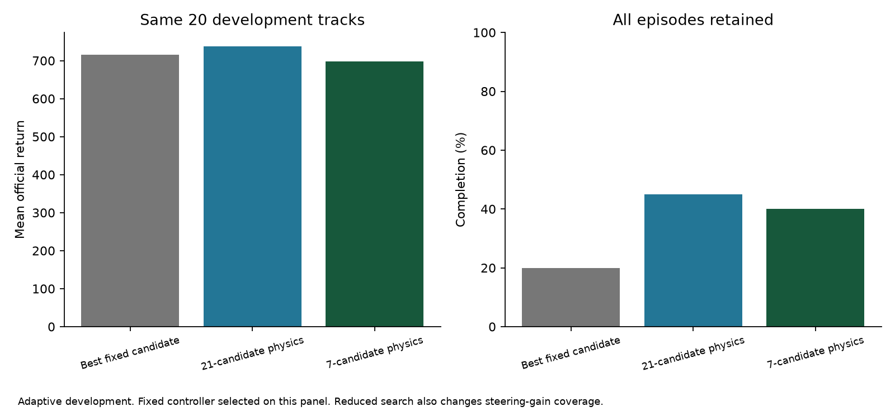

# Programmed simulator: completed development comparisons

2026-10-28. [Index](../README.md) · [Active design](SIMULATOR_SEARCH_PLAN.md) ·
[Status](STATUS.md) · [Earlier control audit](CONTROL_AUDIT_2026-10-28.md)

Subsequent work: the proposed full-map diagnostic below is now complete and
stronger-driver preparation has progressed. See the
[follow-up report](GEOMETRY_AND_DRIVER_2026-10-28.md). This report preserves the
P0/P1 evidence and decisions as they stood at that checkpoint.

The user's intended architecture now runs: estimate from permitted observations,
simulate candidate behaviors with programmed vehicle physics, select by simulated
outcome, execute briefly and replan. No new transition model, critic or selector
was trained. This is a working prototype with useful evidence, **not an established
performance advantage or SOTA result**.

## What was implemented

`models/physics.py` reuses the locked Gymnasium vehicle equations and Box2D solver
at the official 50 Hz. Every candidate receives an independent reconstructed
world. The planner receives only the existing local road mask, ego velocity/yaw
rate and previous action. It never clones the evaluation environment or reads
true hidden wheel state, the hidden road or track identity.

The observer carries the selected candidate's first simulated wheel-state estimate
to the next decision and corrects hull motion using the next permitted observation.
Road contact uses five footprint points per wheel, not exact polygon intersection.
Reconstructed joints discard solver warm starts. These approximations are declared
in every run; reusing the vehicle code does not make the whole internal world exact.

All search conditions retain the previous coded progress/clearance/center/slip/
unknown-space utility, a 20-decision (1.6 s) horizon, and four-frame execution
before replanning. This utility is not the official reward. One straight-continuation
road hypothesis is used; a calibrated distribution over worlds is not implemented.

## Campaign declarations and comparisons

P0 was declared in [programmed-physics-2026-10-28.json](../configs/campaigns/programmed-physics-2026-10-28.json)
before execution: two conditions on the same 20 development tracks, at most
40,000 native evaluation frames and 16.8 million internal physics frames.

- Bounded bank: target speeds 20/25/30/35/40/45/50 × steering gains 0.8/1.0/1.2.
  This matches the corrected ridge-model bank and score.
- Wider bank: target speeds 30/40/50/60/70/80/90 × the same gains.
  Changing this family is a separate intervention from replacing the dynamics.

P1 was an **adaptive follow-up**, declared in
[physics-budget-2026-10-28.json](../configs/campaigns/physics-budget-2026-10-28.json)
after P0 revealed excessive latency: restrict the wider bank to gain 1.2, leaving
seven candidates. That gain came from the earlier fixed-controller audit. Complete
the fixed-controller comparison across all 21 wider candidates, reusing ten prior
conditions and running eleven missing ones. P1 caps were 240,000 new native frames
and 2.8 million internal physics frames. All conditions used the same 20 tracks.

| Controller | Mean official return | Completion | Decision latency p95 |
|---|---:|---:|---:|
| Best fixed controller from wider family: speed 50, gain 1.2 | 716.1 | 20% | — |
| Corrected ridge search, bounded 21, mean of three fitted models | 681.9 | 20% | — |
| Programmed physics, bounded 21 | 653.6 | 20% | 127.4 ms |
| Programmed physics, wider 21 | 737.3 | 45% | 128.5 ms |
| Programmed physics, wider 7, gain 1.2 | 697.8 | 40% | 48.9 ms |

The fixed reference was selected by development mean return, then completion and
candidate index; it is not an independently selected test comparator. All failures
are retained. The 21-candidate wider search completed 9/20 races, the seven-candidate
search 8/20, and the best fixed controller 4/20.



Paired 95% bootstrap intervals over these 20 shared tracks (5,000 replicates):

| Return difference | Estimate | 95% interval |
|---|---:|---:|
| Wider 21 physics minus best fixed | +21.2 | [−97.6, +156.8] |
| Wider 7 physics minus best fixed | −18.4 | [−97.8, +58.1] |
| Wider 7 physics minus wider 21 physics | −39.5 | [−179.9, +93.5] |
| Bounded 21 physics minus best fixed | −62.5 | [−142.8, +6.9] |

None establishes a mean-return advantage. These are exploratory intervals, not
adjusted for repeated development selection or multiple comparisons. The seven-
candidate completion difference versus fixed is +20 percentage points with interval
[+5, +40], but the same adaptive-development limitation applies. Twenty repeatedly
used tracks are not sufficient evidence of a generalization or SOTA claim.

## What we learned about prediction and control

On exactly the same observed transitions and chosen actions, the new engine's
one-step ego predictions are substantially closer to the subsequent measurements
than the three frozen ridge models. Only full four-frame transitions are included.
Velocity errors are in simulator m/s and yaw-rate errors in rad/s. No privileged
candidate-ranking values are involved.

| Trajectories / predictor | Forward-velocity RMSE | Lateral-velocity RMSE | Yaw-rate RMSE |
|---|---:|---:|---:|
| Bounded physics trajectories / physics | 0.0548 | 0.0630 | 0.0289 |
| Same 4,761 transitions / ridge models, range | 0.596–0.601 | 0.668–0.730 | 0.255–0.257 |
| Wider physics trajectories / physics | 0.0993 | 0.1057 | 0.0466 |
| Same 4,397 transitions / ridge models, range | 1.022–1.165 | 1.654–1.741 | 0.490–0.497 |

This establishes one-step prediction improvement on these trajectories, not
accurate long-horizon rollouts or correct candidate ranking. The physics backend,
state observer and wheel-contact treatment changed together. Despite better
one-step prediction, the bounded controller did not improve mean driving return.
Model accuracy alone therefore does not resolve the control problem.

The bounded planner selected its maximum target speed on about 96.6% of decisions.
Widening the bank changes available pace and substantially changes behavior.
It also increases mean off-road frames from 54.1 to 110.8. Outcome counts:

| Physics search | Completed | On-road timeout | Off-road timeout | Playfield exit |
|---|---:|---:|---:|---:|
| Bounded 21 | 4 | 12 | 2 | 2 |
| Wider 21 | 9 | 6 | 5 | 0 |
| Wider 7 | 8 | 9 | 1 | 2 |

These endpoint categories describe outcomes; they do not identify their cause.
The seven-candidate change reduces both compute and steering-gain coverage, so
it is not a clean demonstration of a better search optimizer.

## Cost, latency and verification

| New work | Episodes | Native evaluation frames | Internal physics frames |
|---|---:|---:|---:|
| P0: two physics conditions | 40 | 36,663 | 15,407,280 |
| P1: one physics condition and eleven fixed conditions | 240 | 210,765 | 2,367,120 |
| Campaign total | 280 | 247,428 | 17,774,400 |

There are **20 distinct development tracks**, not 280 independent environments.
No model training occurred in these campaigns. Prior collection/training/tuning
costs remain in the earlier reports and are not erased by these zero-new-training runs.

The decision interval is 80 ms. Campaign latency includes sensor construction and
policy execution, including internal simulation; it excludes actual environment
stepping and disk I/O. Both 21-candidate runs missed every recorded deadline. The
seven-candidate run's episode-mean missed-deadline fraction was 0.02%. Jobs shared
the workstation, so an additional isolated timing check used 20 recorded observations,
three repetitions, alternating method order and resetting the observer per case:

- Seven candidates: p50 43.7 ms, p95 45.8 ms, maximum 46.5 ms.
- Twenty-one candidates: p50 112.0 ms, p95 123.6 ms, maximum 136.9 ms.

These isolated timings exclude sensor construction, environment stepping and disk;
history-reset snapshots are a timing check, not state-prediction validation or an
end-to-end real-time guarantee. Raw timing records and the source/config snapshot
are in `runs/verification/physics_search_20261028/`.

Deterministic replay of the first seven-candidate episode reproduced every action,
reward, permitted observation and ending flag exactly: 681 native frames and
171 decisions. This is reproducibility evidence, not an independent performance
replication. Replay added 95,760 internal physics frames; the timing check added
134,400. They are separate from the campaign totals above.

The complete suite passed **66 tests**, with three upstream SWIG warnings. New
tests cover a synthetic upstream-physics comparison, independent candidate worlds,
first-transition state carry-over and deterministic reset. The
[verification record](../reports/physics_budget_2026-10-28/verification.json) stores
replay and timing results. Final-test and legacy unseen/hard data remain sealed;
the user-only rank/regret monitor was not read or used. All jobs are finished.

## Decisions and next diagnostic

These are assistant decisions under the user's autonomous-execution instruction:

1. Retain the programmed engine: it implements the intended architecture and
   improves short-term prediction. Do not call it an exact state clone.
2. Keep seven candidates as the low-cost reference and 21 as the larger-budget
   reference. Neither is a demonstrated final winner. Candidate utility, maneuvers,
   horizon, geometry assumptions and the latent observer remain open choices.
3. Next proposed diagnostic: give these same planners explicitly declared full-map
   geometry, retaining the same estimated vehicle state, score and horizon.
   Two conditions × 20 development tracks imply a 40,000-native-frame cap. This
   is **proposed, not launched**; declare the adapter and manifest first. Report
   it separately as privileged, including any path-representation differences.
   It must not read true wheel state or the private candidate oracle.
4. If this substantially improves driving, prioritize permitted road reconstruction/
   hypotheses and simulation across shared worlds. Otherwise investigate candidate
   maneuvers, objective/horizon and state/contact errors. A weak full-map result
   would not alone identify which remaining component failed.
5. A competent frozen learned proposer, matched random/adaptive planning controls,
   broader development evaluation and native-input comparisons are still needed
   before any serious standard-CarRacing performance claim.

The uncertainty table and prior-art critique remain in the
[active design](SIMULATOR_SEARCH_PLAN.md). This evidence does not justify removing
stronger baselines or replacing the user's main idea with predictor-loss research.

## Reproduction and public artifacts

P0 runs are `runs/physics_search/physics_pilot_20261028_{bounded,wide}`. P1's physics
run is `runs/physics_search/physics_budget_20261028_gain12`; its fixed references
are listed explicitly in the manifest. Campaign runner records live under
`runs/campaigns/physics_pilot_20261028/` and `runs/campaigns/physics_budget_20261028/`.
Each run retains config, source snapshot, metrics, costs and episode traces.
Completed run IDs must never be overwritten.

```bash
# New seven-candidate development run; choose a fresh run ID.
uv run python -m cars.cli research evaluate --method physics --speed-grid 30 40 50 60 70 80 90 --gain-grid 1.2 --horizon 20 --episodes 20 --run-id NEW_PHYSICS_RUN
# Rebuild summaries from the explicit existing public runs; no new racing.
uv run python scripts/summarize_physics_pilot.py
uv run python scripts/summarize_physics_budget.py
```

Public artifacts: [P0 analysis](../reports/physics_pilot_2026-10-28/analysis.json),
[P0 summary](../reports/physics_pilot_2026-10-28/summary.csv),
[P0 figure](../reports/physics_pilot_2026-10-28/physics_pilot.pdf),
[P1 analysis](../reports/physics_budget_2026-10-28/analysis.json),
[all fixed candidates](../reports/physics_budget_2026-10-28/fixed_candidates.csv),
[P1 figure](../reports/physics_budget_2026-10-28/physics_budget.pdf).
