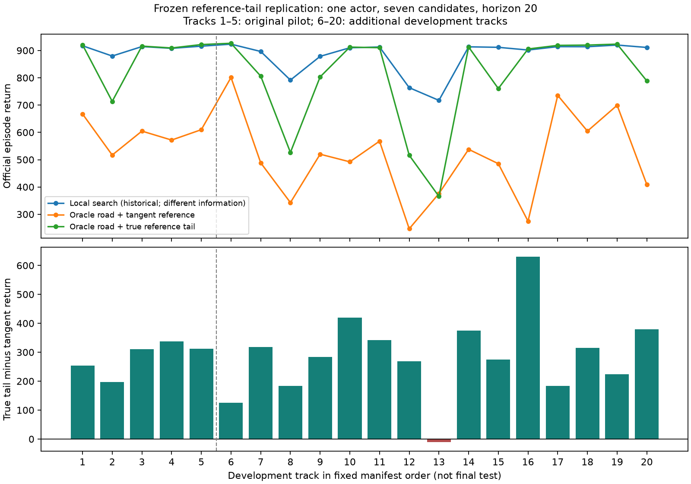

# Frozen reference-tail replication on 20 development tracks

[Index](../README.md) · [Specification](EXPERIMENT.md) · [Pilot](REFERENCE_CONTINUATION_2026-10-29.md)

## Origin, purpose and status

**User instruction:** continue the controlled intervention work; document choices,
uncertainty and idea origin. **Assistant design:** replicate the two unchanged
reference-tail conditions before tuning to the remaining pilot failure. This is a
fixed-controller geometry diagnostic within the user's understanding-versus-deciding
study. It does not train or establish the full V/L/F policy comparison.

**Complete.** Both 20-track conditions finished, with all ten exact episode replay
checks passed. True continuation improved mean return by **286.25** over the
tangent control, but remained **71.86 below historical local search**. The gain
repeated on the additional fifteen tracks; it was not universal. No jobs remain
active from this campaign. The frozen campaign launched after commit `9815c84`
and validation. The completed five-track pilot found +282.09 mean
return for true continuation versus a tangent tail with the same oracle road model,
but −30.70 versus original local search. This motivated replication with unchanged settings.
No production controller code changed in this batch.

Frozen declaration: [manifest](../configs/campaigns/reference-replication-2026-10-29.json),
SHA256 `ed70036b319e18531023e9ce8545deb87df90114dd0dbcccfbea7718aa135f2e`. New run IDs and files are distinct from every completed pilot.

## Conditions and information

Both newly evaluated conditions use the same frozen local recurrent actor,
checkpoint `frames_001007379` from `driver_main_20261028_s0_to2m`, the same
observation-initialized programmed vehicle model and oracle road outside the
current footprint. Actor inputs/history remain local; no true wheel/solver state,
environment clones or private candidate rankings are available.

| Condition | Objective reference | Road model | Role |
|---|---|---|---|
| Tangent | True visible prefix plus 100 m straight tangent | Oracle continuation, original raster inside footprint | Primary control |
| True tail | Exactly the same visible prefix plus 100 m true directed arc | Identical oracle road model | Only changed module |
| Local search | Reconstructed local path plus tangent | Local raster plus tangent prior | Historical, different-information context |

Seven feedback candidates, 20 imagined decisions, action repeat four, planning
seed zero, three residual knots, sparse imagined observations, score weights,
observer and root outside-footprint penalty all remain unchanged. True tail keeps
one-metre sampling. Both reference variants affect progress and centre-distance
scoring together; this experiment cannot identify either cost term alone.

The context reuses only the first 20 episode trajectories of
`broad_driver_20261028_search7`; its full-run metrics/config/cost are pinned for
integrity. It is not a third newly evaluated condition or an equal-information
control. Its historical timing cannot support a paired timing superiority claim.

## Fixed sample, analysis and budgets

- First 20 tracks in the existing development manifest, fixed before this run;
  same ordered tracks in every condition. The declaration records all 20 seeds.
- Report all20, original5 and additional15 separately, regardless of outcomes.
  Original5 informed this intervention. Additional15 were already used by the
  historical local controller and remain development data, not a final holdout.
- Primary contrast: true-tail minus tangent official return, paired by track.
  Also report completion, progress, off-road frames, playfield exits, sampled
  speed, braking, reference fallbacks and latency. Preserve all failures.
- Nominal paired-track bootstrap: 5,000 draws, report seed zero, all20/additional15
  only; original5 stays descriptive. These intervals condition on one frozen actor
  and one planning stream, with no selection adjustment or training-seed uncertainty.
  The three overlapping panels are not independent replications or formal tests.
- Forty episodes maximum: **40,000 new native environment frames / 5,600,000
  internal native physics steps**, zero new training. The original five episodes
  per condition are replay checks within these 40 episodes, not extra races.
- Serial tangent then true-tail execution, one CPU thread, no competing project
  training/racing. No early favorable stopping, tuning during the run, automatic
  expansion to 200, or final-test access. Stop and retain artifacts on integrity
  failure; a repaired or expanded run requires a new declaration.

**Assistant confidence:** high in the isolation and replication design after the
existing geometry/candidate/memory tests; uncertain whether the effect extends to
15 additional tracks or improves over local search. Twenty is a bounded diagnostic
budget, not a power calculation or a headline paper sample. One stream and a
locally trained proposer remain limitations even if the gain repeats.

## Execution and checks

```bash
uv run python scripts/run_reference_replication.py --manifest configs/campaigns/reference-replication-2026-10-29.json
```

The runner copies executable sources and scripts, verifies checkpoint, partition,
dependency and input hashes, and records child commands and live technical status.
As the original five episodes complete in each condition, compare every recorded
array with its pinned pilot counterpart except wall-clock timing. Stop on mismatch.
Observations, actions, rewards, termination, frame counts and off-road indices must
match exactly. Check complete episode counts and costs before publishing summaries.

Campaign directory: `runs/campaigns/reference_replication_20261029`.
Completed report directory: `reports/reference_replication_2026-10-29`.
The report includes per-panel summaries, all paired episode results, executed
behavior, nominal intervals, a paired-return figure and source/artifact provenance.
No monitor rank/regret outputs or reserved test results are read.

Validation before launch: **90 tests passed** (three upstream SWIG warnings);
runner/reporter/evaluator CLI discovery, pinned input/configuration checks and all
32 local documentation files passed. Ordinary disposable unit-test environment/
model fixtures are infrastructure work, outside this campaign; no new paper training
or evaluation runs occurred before launch.

## Completed results

Finished **2026-10-29 08:38:20 UTC / 11:38 Moscow**. The primary comparison uses
two newly executed conditions; local search reuses the declared historical run.

| Panel | Tangent return / finishes | True-tail return / finishes | Local context return / finishes |
|---|---:|---:|---:|
| All 20 | 527.60 / 0 of 20 | 813.85 / 12 of 20 | 885.70 / 14 of 20 |
| Original 5 | 594.21 / 0 of 5 | 876.29 / 4 of 5 | 906.99 / 4 of 5 |
| Additional 15 | 505.39 / 0 of 15 | 793.03 / 8 of 15 | 878.60 / 10 of 15 |

| Panel | True tail minus tangent | Tracks improved | True tail minus local context |
|---|---:|---:|---:|
| All 20 | +286.25 [231.59, 343.19] | 19/20 | −71.86 [−122.60, −28.95] |
| Original 5 | +282.09, descriptive | 5/5 | −30.70, descriptive |
| Additional 15 | +287.64 [216.83, 362.18] | 14/15 | −85.57 [−146.70, −33.52] |

Brackets are the declared **nominal 95% paired-track bootstrap intervals**.
They do not account for adaptive development selection or training/planning-seed
uncertainty. All20 includes the pilot cases; additional15 is still development.
Completion increased by 60 percentage points overall [40, 80] and by 53.33
points on additional15 [26.67, 80] relative to tangent. Compared with local search,
completion decreased by 10 points overall [−25, 0]; no new track was completed
that local search failed. These intervals are descriptive, not a final-test claim.

| All-20 measurement | Tangent | True tail | Local context |
|---|---:|---:|---:|
| Mean progress | 62.76% | 90.40% | 97.64% |
| Mean sampled speed | 30.90 m/s | 50.81 m/s | 54.95 m/s |
| Mean brake | 0.0387 | 0.0165 | 0.0109 |
| Total off-road native frames | 0 | 2 | 38 |
| Playfield exits | 0 | 0 | 0 |
| Pipeline p95 | 219.57 ms | 219.58 ms | 134.83 ms, historical |

All decisions exceeded the 80 ms action interval in every condition. The environment
waits for planning; no deadline fallback is used. This is not real-time performance.
There were no reference fallbacks in either intervention condition. Fewer departures
while driving more slowly do not establish safety or overall control superiority.

## Failures and interpretation

All twenty tangent episodes timed out without any recorded off-road frames.
True tail had eight timeouts: tracks **2, 7, 8, 9, 12, 13, 15 and 20** in one-based
manifest order. Seven had zero off-road frames; track 12 had two. All six local
timeouts are in this set; tracks 15 and 20 are additional failures under true tail.

Track **13** is the primary counterexample: true tail **365.52**, tangent **375.86**
(−10.34), local **717.24**. Its progress was 46.55%, sampled speed 22.41 m/s and
mean brake 0.0502. The original five's universal per-track gain did not generalize.
Against local search, ten returns rose and ten fell, with larger losses: gains were
at most +6.00, while the largest loss was −351.72. These failures are not excluded
from means, intervals, plots or logs.

**Supported conditional finding:** with this fixed proposer, oracle road model,
observer, candidate distribution and utility, changing only the future objective
reference recovered substantial driving performance on a broader development panel.
Objective/reference compatibility is a measured limitation of the preceding oracle
configuration; accurate recorded-action motion prediction alone was insufficient.
Progress and centre-distance costs change together, so their effects remain combined.

**Not established:** a universal benefit, an optimal control ceiling, a complete
diagnosis of the policy's neural perception/prediction, or superiority to local search.
This intervention still supplies privileged information, uses one frozen locally
trained actor and one planning stream, and leaves state/contact and utility
approximations. It does not identify a unique cause of the remaining failures.
No SOTA, safety, physical transfer or full V/L/F result follows.

## Verification and costs

- **90 tests passed**, three upstream SWIG warnings; CLI discovery and local links
  passed before execution. No production controller code was changed for replication.
- **Ten complete episodes replayed exactly**, five per condition. Only recorded
  wall-clock timing was excluded. These checks used episodes inside the declared 40.
- Frozen/live production sources, all pinned inputs, all 60 report trajectories
  and their public diagnostic file hashes, and paired return contrasts were checked
  after completion. The PNG figure was visually inspected.
- Tangent: **20,000 native / 2,800,000 internal physics frames**, 670,000 actor-forward
  examples, 1,029.50 s evaluation wall time.
- True tail: **18,031 native / 2,526,720 internal physics frames**, 604,608 actor-forward
  examples, 918.18 s evaluation wall time.
- Total new campaign: **38,031 native / 5,326,720 internal physics frames**, **1,274,608
  actor-forward examples**, **1,962.86 s (32.71 minutes)** including checks/reporting.
  Both caps passed, zero new experiment training. Historical context costs are not
  counted again. Final integrity checks used zero simulator frames.
- CPU: AMD Ryzen 5 7500F, one computational thread per racing process. Conditions
  ran serially; ordinary workstation load/frequency remained uncontrolled. Host
  metadata and final integrity evidence are saved in the campaign directory.

Public artifacts: [summary](../reports/reference_replication_2026-10-29/summary.csv),
[all paired episodes](../reports/reference_replication_2026-10-29/episodes.csv),
[executed behavior](../reports/reference_replication_2026-10-29/executed_behavior.csv),
[intervals, costs and provenance](../reports/reference_replication_2026-10-29/analysis.json),
[verification and host record](../reports/reference_replication_2026-10-29/verification.json),
[figure PNG](../reports/reference_replication_2026-10-29/paired_returns.png) /
[figure PDF](../reports/reference_replication_2026-10-29/paired_returns.pdf).



## Decision after results

**Assistant recommendation:** close this bounded reference-tail diagnostic with
both findings preserved. Retain the original local search as the working local
method; true tail stays a privileged diagnostic, not a promoted replacement.
Do not expand to 200 tracks or tune specifically to tracks 13/15/20 based on this run.

The next implementation priority is the already [audited established-optimizer
comparison](SEARCH_OPTIMIZER_AUDIT.md): matched full-sequence colored shooting
versus a policy-guided iCEM adaptation with the same local information, simulator,
actor and actual rollout budget. The original knot representation remains a
separate control. Synthetic memory/budget/state-commit tests and a separately
declared smoke/campaign manifest must precede new racing. This closes a missing
method-comparison gate; performance improvement is uncertain, and better internal
optimization could exploit model/objective errors. It is **not launched here**.
Baseline competence/reproduction and the trained V/L/F interfaces remain required
for the paper's main decomposition claim. Neither is replaced by this replication.
