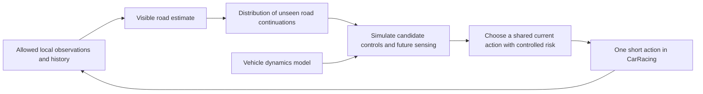

# Geometry research branch: when does imagining unseen geometry help control?

Research date: 2026-10-27. Status: literature-grounded proposal, no new algorithm
implemented or benchmark result established. Scope agreed with the user:
**Gymnasium CarRacing only, simulation only, current workstation first.**

This document details one branch of the broader prediction/simulation/control
system in [USER_INTENT.md](USER_INTENT.md). Hidden-road forecasting and its
information-gap gates apply to that branch. They are not the sole main project.
For optional prediction-space selection after normal training, see
[PREDICTION_SELECTION.md](PREDICTION_SELECTION.md). No special decision-focused
predictor loss or fixed 100 m forecast is required by the user.

This report distinguishes verified prior work, repository observations, and our
hypotheses. Literature search cannot prove that a proposed mechanism is novel.
Paper/repository availability was checked; reproductions have not been run.
The active experiment specification is [EXPERIMENT.md](EXPERIMENT.md); the old
comparison is preserved on the [archive branch](ARCHIVE.md).

## 1. Assessment

The proposed decomposition is technically sensible: estimate visible geometry,
maintain uncertainty about the hidden road, predict the consequences of actions,
then execute a short action and replan. It gives us unusually good access to
failure diagnosis. Geometry, dynamics, and control can be tested independently
and then recombined.

The broad idea is not novel. Learning internal worlds, controlling through
imagined trajectories, reconstructing local road geometry, and using uncertain
maps for planning all have substantial prior art. A paper presenting only this
pipeline plus a win over our current PPO/SAC would be weak.

The question for this geometry branch is:

> Can explicit geometric beliefs produce better decisions under limited
> visibility, and can we identify which uncertainty and future observations are
> responsible for the improvement, at a practical inference budget?

My assessment:

| Dimension | Assessment | Reason |
|---|---|---|
| Broad architectural novelty | Low | Most ingredients and several close combinations already exist |
| Feasibility of a compact prototype | Good | Low-dimensional geometry, an existing simulator/evaluator, and a 16 GB GPU |
| Evidence of a performance advantage | Unknown | Strong recurrent policies can already learn road priors; imagination can hurt |
| Scientific interest | Promising if focused | Separating prediction quality, uncertainty, information, and action quality is useful |
| Standard CarRacing SOTA | Unverified | No authoritative, protocol-matched current ranking was established by this search |
| Top-tier paper with only this simulator | Possible but high risk | Requires a substantive methodological or scientific result, not just a score increase |

One simulator is acceptable as a project constraint. Multiple seeds and sensor
ranges improve internal validity, but do not become independent real-world
domains. A top ML main-track submission would need a particularly strong general
insight, algorithm, or analysis to overcome this limitation. A game/agent-learning
venue is a more natural fit than a claim of real-robot autonomy. These are research
judgments, not predictions of acceptance. We should aim for one defensible
contribution rather than SOTA in perception, dynamics, planning, and RL separately.

## 2. Closest prior work and what it rules out

The following sources are papers, author project pages, proceedings, and official
code. Third-party leaderboards and informal reproductions were search leads,
not evidence of an established SOTA score.

| Work | Relevant finding | Consequence for our paper |
|---|---|---|
| [World Models, Ha and Schmidhuber, 2018](https://worldmodels.github.io/) | Separates vision, predictive memory, and control; includes CarRacing. Training entirely inside a learned dream is demonstrated in its Doom experiment. | Neither decomposition nor learned imagination is new. Do not conflate its CarRacing experiment with its dream-transfer experiment. |
| [Learning to Predict Without Looking Ahead, Freeman, Metz and Ha, 2019](https://learningtopredict.github.io/) | Uses observational dropout, including CarRacing, to study useful internal predictions. | Restricted observations and imperfect but useful world models already have direct CarRacing precedent. |
| [PETS, Chua et al., 2018](https://arxiv.org/abs/1805.12114) | Probabilistic dynamics ensembles and sampled rollouts support MPC. | Sampling uncertain dynamics is a baseline, not our contribution. |
| [Learning by Cheating, Chen et al., 2019](https://arxiv.org/abs/1912.12294) | Privileged training is separated from sensor-only deployment for driving. | Ground-truth supervision followed by visual deployment is established; disclose and match that supervision. |
| [High-performance Racing on Unmapped Tracks using Local Maps, Evans et al., 2024](https://arxiv.org/abs/2401.17732) | Builds local geometry from LiDAR for optimization-based racing without a global map. | Local mapping plus classical control is a strong conceptual baseline. It must be adapted to CarRacing, not compared using foreign lap-time numbers. |
| [Uncertainty-Aware Perception-Based Control for Autonomous Racing, Trisovic et al., 2025](https://arxiv.org/html/2508.02494v1) | Fits RGB-D road curvature, samples geometric uncertainty, and uses multi-scenario MPCC. Section VII constrains predictions to the perceived road and shares a control sequence across scenarios. | Extremely close. A possible distinction is learning genuinely unseen continuations and accounting for their future revelation. This distinction still needs a broader novelty check. |
| [MapDiffusion, Monninger et al., IROS 2025](https://arxiv.org/abs/2507.21423) | Predicts multiple plausible vector maps and uncertainty from visual features. | Probabilistic geometric reconstruction itself is not new. |
| [CogniPlan, Wang et al., CoRL 2025](https://proceedings.mlr.press/v305/wang25d.html) | Uses multiple generatively completed layouts for uncertainty-aware exploration/navigation. | The combination of imagined unseen maps and planning is also established outside racing. |
| [Predicting the Road Ahead, Manchingal et al., 2025 preprint / ICRA 2026](https://arxiv.org/html/2510.22680v1) | Classifies upcoming road layout with uncertainty and adjusts vehicle speed. [Author publication record](https://jkooij.github.io/publications/2026_uroadpred/). | A learned turn distribution plus slowing when uncertain is not enough for novelty. |
| [Valdi, Lindenberg and Chitta, July 2026 preprint](https://arxiv.org/html/2607.00917v1) | Studies stochastic latent diffusion MPC directly in CarRacing; preliminary results expose tension between multimodality and control. Uses modified visual/proprioceptive inputs and a 600-frame limit. | Mandatory close reading and reproduction attempt. Its published numbers are not directly comparable with our 1000-frame protocol. |
| [TD-MPC2, Hansen, Su and Wang, ICLR 2024](https://arxiv.org/abs/2310.16828) | A strong continuous-control world-model/planning method. | We must compare against learned latent planning, not only PPO/SAC. |
| [DreamerV3, Hafner et al., Nature 2025](https://www.nature.com/articles/s41586-025-08744-2) | Learns behavior through imagined latent trajectories across many domains. | Strong recurrent world-model baseline; its original paper is not an authoritative CarRacing leaderboard. |
| [Dreamer 4, Hafner, Yan and Lillicrap, 2025](https://arxiv.org/abs/2509.24527) | Learns policies inside scalable video world models, demonstrating an offline Minecraft task. | Relevant contemporary context; recreating its full training setup is unnecessary for this workstation-sized study. |
| [MR.Q, Fujimoto et al., 2025](https://arxiv.org/abs/2501.16142) | Modern general-purpose model-free RL. | A candidate strong model-free check beyond the existing PPO/SAC implementations. |
| [Task-based End-to-end Model Learning, Donti, Amos and Kolter, NeurIPS 2017](https://arxiv.org/abs/1703.04529) and [TaskMet, Bansal et al., NeurIPS 2023](https://arxiv.org/abs/2312.05250) | Train predictions with downstream decision quality in mind. | A decision-sensitive prediction loss is not automatically a new idea. |
| [POMCPOW / continuous POMDP planning, Sunberg and Kochenderfer, ICAPS 2018](https://arxiv.org/abs/1709.06196) | Handles belief-space planning and pitfalls of impoverished uncertainty representations. | Planning over observations and beliefs has established foundations; sampled futures alone do not solve partial observability. |

Two further references are useful for the eventual related-work section:
[Neuroevolution of Self-Interpretable Agents](https://attentionagent.github.io/)
for historical visual CarRacing comparisons, and
[Transfer Learning for Customized Car Racing Environments](https://arxiv.org/html/2605.17928v1)
for a recent simulator-specific transfer study. Neither supplies a verified
standard-v3 SOTA target for our protocol.

### The candidate contribution

Investigate a compact geometric belief whose calibration is checked on
**control-relevant events**, coupled to planning that respects when hidden road
segments become observable. Evaluate it using controlled information changes and
counterfactual geometries. The contribution could be an effective mechanism for
this interface, or a rigorous account of when structured imagination helps and
when it fails.

The novelty case must survive comparison with Trisovic, CogniPlan, MapDiffusion,
Valdi, and decision-focused learning. Merely concatenating their ingredients is
not enough. At present this is a research direction, not a discovered novel
algorithm. Do not write an abstract claiming improvements before measuring them.

## 3. Formalize the problem before adding models

Let `m` be a fixed road geometry, `z_t` the vehicle state, `d` the dynamics
parameters, and `h_t` the allowed observation/action history. Maintain a belief
`b_t(m, z_t, d | h_t)`. The road does not physically change between frames:
uncertainty describes our lack of observation, not random bends appearing while
we drive. Distinguish that ambiguity from finite-data model uncertainty and
sensor noise.

A practical factorization starts with `q_phi(m | h_t)` and a separate compact
dynamics model `f_theta(z, a, local_road)`. This is a modeling choice, not an exact
independence theorem. Tire-road contact means geometry can affect dynamics.

The method pipeline is:

A conceptual objective is `min_pi E_b[L(pi)] + lambda * CVaR_alpha(L(pi))`, where
`L` includes progress/time, departures, and control regularity. CVaR here means
mean loss in the worst `1-alpha` tail. This internal planning cost must be
reported explicitly and does not replace the official environment reward.
A sample-based penalty is not a formal guarantee of safety.

Important constraints on the implementation:

- Optimize an action/policy across sampled roads; never pick the most convenient
  road or average individually optimal steering commands.
- Keep each sampled road fixed during its rollout. Resampling each step would
  make the road incoherent and the computed risks misleading.
- The same observable history requires the same action. A scenario-specific
  future action can differ only after the simulated sensor distinguishes the
  scenarios. Sharing only the first action and then giving every branch full
  road knowledge introduces optimistic hindsight bias.
- Begin with a valid shared open-loop sequence, then test an observation-based
  feedback rollout policy or a small observation-branching tree. A particle's
  hidden identity is never an input to that feedback policy.
- Start without a learned terminal value. Later compare against one trained on
  the same allowed history/belief, since a short MPC horizon can otherwise be
  an unfair disadvantage against RL.
- Compare planning against a learned policy consuming the **same** belief. That
  isolates whether the benefit comes from representation or online search.

The geometry is planar. For this paper a centreline/road-boundary representation
is more appropriate than 3D reconstruction or a general video generator. A
supervised geometry metric is a diagnostic, not a certificate that control is
correct: small errors at a sharp turn can matter more than large errors far away.

### A useful physical diagnostic

For measured effective deceleration `b` and latency `tau`, use the approximate
braking distance `d_brake = v^2/(2*b) + v*tau` as a diagnostic, not a proven bound
under tire slip. Study the ratio of visible road length to braking distance.

If the road is visible well before braking is needed, prediction may add little.
If it becomes visible too late, a driver needs informative priors or must slow
down. If the unseen continuation is conditionally unpredictable, learning cannot
recover its actual realization: it can only estimate risk. This gives us a
falsifiable reason for an advantage, and regimes in which we expect no advantage.

## 4. Gym-only experimental design

Use one engine with explicitly separated protocols, not a mixture of scores.
The [official environment](https://gymnasium.farama.org/environments/box2d/car_racing/)
has continuous controls and native 96x96 RGB observations. State access and
restricted-view wrappers change the information problem even if physics and
reward are preserved.

### Information ladder

| ID | What the policy gets | Interpretation |
|---|---|---|
| G | Full road and declared ego state | Privileged diagnostic reference; an approximate planner here is not a mathematical upper bound |
| L | Ground-truth boundaries only inside the sensor footprint, validity mask, body velocity/yaw-rate sensors, prior controls | Main mechanism study without perception error |
| V | Local fixed-view RGB/mask and exactly the same ego sensor channels | Reconstruction plus forecasting plus control |
| S | Untouched native pixel stream, with no additional hidden-state channels | Optional standard-benchmark track; mandatory if claiming standard CarRacing SOTA |

L and V should share a geometric footprint, so L exposes the visible geometry
underlying V rather than a longer centreline preview. Initially use a fixed
car-frame footprint with a small set of ranges, for example 15/30/60/120 simulator
metres. These are pilot candidates, to be finalized on development data after
checking road width and actual braking distances. A range-clipped top-down view
is not a physical camera or occlusion model. Report exactly which is used.

Distinguish one model trained over declared sensor ranges from separately
trained models at each range. Give learned baselines history, not just one frame;
benchmark recurrence and frame stacking as appropriate. If global pose is used
for an oracle, do not silently provide it to local methods. Apparent course
progress, globally computed lateral error, tile indices, and full-map curvature
are not local sensors.

The current native renderer zooms in during the first second, as confirmed by
inspection of installed upstream `CarRacing._render`. A local policy must not see
an early wide-area overview and then be described as never having seen that road.
Create a fixed-scale local rendering from the first frame. Do not silently change
the native S protocol to remove this behavior.

### Training information ladder

**Structured-supervision track:** simulator geometry labels from training tracks
are allowed. All methods using them report label and collection cost. Include a
recurrent policy with identical geometry auxiliary supervision and a recurrent
policy using the same frozen perception/belief representation.

**Observation-only track:** models learn from permitted observations, actions,
and rewards. Hidden truth can be used by the evaluator, but not by optimization,
model selection on test data, or hidden-label losses. This track is a later
extension; it must not be claimed for a supervised implementation.

**Dynamics access:** explicitly label analytic approximate dynamics, learned
residual dynamics, and exact simulator dynamics. Exact physics knowledge is
extra prior information; matching observations does not erase that advantage.
For the primary planner comparison use the same dynamics model across variants.

### Distribution and counterfactual tests

1. **Standard generator:** independent training/development/test tracks under
   the unchanged generator. This is the main generalization test.
2. **Visibility and sensor shift:** separately vary range, observation noise,
   dropout, and delay. Train/tune only on declared development conditions.
3. **Dynamics shift:** vary grip in a separate labeled condition, keeping geometry
   fixed, so a gain is not confused with shape extrapolation. Keep the legacy
   hard split untouched as a final joint stress test.
4. **Geometry shift:** separately labeled diagnostic track families with held-out
   combinations of bends/straights. Reward and dynamics follow the same engine;
   these are not standard-generator benchmark scores.
5. **Matched-prefix counterfactuals:** construct roads with identical observed
   history but different hidden continuations, and test response as they become
   visible. Include informative and deliberately uninformative continuation
   distributions. This can expose leakage, incorrect certainty, and hindsight
   bias directly.

Counterfactual tracks require care: matching the visible centreline alone is
insufficient. Match road surfaces, allowed ego history, sensor images, and any
reward history supplied to the model. The official per-tile reward depends on
total track tile count; equalize counts or account for that side channel.
Generate compatible complete tracks before an episode rather than mutate the
world mid-drive. Check local physics/contact equivalence under identical actions.
These are diagnostic distributions and must not be mixed into the official table.

We do not need all of these axes crossed with all algorithms. Use the standard
protocol and a few predeclared conditions for headline comparisons; use focused
experiments for each mechanism. Adding dozens of variants does not substitute
for conceptual breadth outside one engine.

## 5. Comparison and reproduction plan

The question is not whether our existing implementations lose. It is whether a
well-implemented competitor with the same information and resources loses.

| Priority | Comparator | Why it matters | Implementation route and limitation |
|---|---|---|---|
| First | Local pure pursuit plus visibility/braking speed limit | Tests whether a simple conservative rule explains the gain | Adapt existing expert to an actually local interface; tune fairly |
| First | Deterministic local MPC | Tests the value of probabilistic unseen geometry | Same dynamics, cost family, horizon, optimizer, and tuning budget as ours |
| First | Scenario MPC with a simple curvature prior | Tests whether ML forecasting is necessary | Fit an empirical/Markov curvature model on training tracks; enforce road continuity |
| First | Learned-mean and learned-samples MPC | Isolates stochastic forecasting | Same fitted forecaster/data where possible; do not confound with a different controller |
| First | Recurrent PPO; competitive SAC/history baseline | Controls for memory and implicit road priors | Existing SB3 foundation plus [official RecurrentPPO](https://sb3-contrib.readthedocs.io/en/master/modules/ppo_recurrent.html); retrain on the new interface |
| Required for strong claim | TD-MPC2 | Strong learned latent planning | [Official code](https://github.com/nicklashansen/tdmpc2); state/pixel support, episodic mode must be configured, history adaptation documented |
| Required for visual world-model claim | DreamerV3 | Recurrent latent imagination with learned behavior | [Author-maintained code](https://github.com/danijar/dreamerv3); benchmark a small configuration and memory footprint first |
| Close-work reproduction | Valdi and its deterministic baseline | Direct recent stochastic MPC work in this simulator | [Author code](https://github.com/Kit115/ValueDiffusionWorldModels); reproduce its setup separately before adapting our matched protocol |
| Diagnostic | PETS-style ensemble dynamics MPC | Separates dynamics uncertainty from geometry uncertainty | [Original code](https://github.com/kchua/handful-of-trials) is legacy; [MBRL-Lib](https://github.com/facebookresearch/mbrl-lib) has PyTorch implementations but is archived; audit compatibility |
| Additional model-free check | MR.Q | Avoids claiming superiority over model-free RL from old baselines alone | [Official PyTorch code](https://github.com/facebookresearch/MRQ); Python 3.12 supported; CarRacing adapter still required |
| Diagnostic | Full-map MPC | Measures benefit of privileged geometry | Same solver/dynamics where possible; report separately |
| Diagnostic | Policy on our frozen belief; BC/DAgger | Separates representation gains from online optimization and imitation | Same inputs/labels; a teacher with hidden future knowledge is explicitly privileged |

Trisovic-style uncertainty around visible curvature is a necessary conceptual
control in noisy-vision experiments. I did not verify a public implementation
for that paper. Implement and label a paper-based adaptation if code remains
unavailable; do not claim exact reproduction.

[MapDiffusion code](https://github.com/tmonnin/mapdiffusion) and
[CogniPlan code](https://github.com/marmotlab/CogniPlan) are available, but transplanting
an entire HD-mapping or navigation system into this game would change the task
substantially. Use them in related work; compare lightweight matched mechanisms
when the contribution overlaps. A paper claiming a new map generator would need
a stronger direct generative comparison than our initial plan.

A faithful reproduction means checking wrappers, termination/truncation,
action-repeat accounting, normalization, model selection, and original curves.
It does not mean only calling code bearing the algorithm's name. Save exact
upstream commits and adaptation patches. Repository presence does not guarantee
compatibility with our Python/CUDA stack. Use separate locked environments where
necessary rather than destabilizing the existing one.

Do not call TD-MPC2, DreamerV3, or MR.Q the established CarRacing champion. They
are credible algorithmic competitors whose performance here has to be measured.
Do not omit a strong baseline because an initial small run fails; investigate
whether the interface/training budget is responsible and report remaining limits.

## 6. Proposed method, from simplest to more ambitious

**Geometry representation.** Sample centreline curvature at fixed arc-length
spacing, integrate it into road boundaries, and retain observed versus predicted
masks. Width is known and constant initially, which is a declared domain prior.
Prevent invalid samples and record rejection rates. Smoothness, continuity, and
non-self-intersection checks cannot secretly consult the hidden track.

**Visible-road module.** Start with oracle-visible boundaries. Later compare
simple color/edge segmentation and spline fitting with a small supervised CNN.
Use sequences/ego motion if required. Train on varied behaviors, including
recoveries and departures, not only flawless expert trajectories.

**Unseen-road module.** Start with empirical curvature statistics, then a small
conditional mixture-density/autoregressive network. It produces complete,
correlated road continuations. A diffusion/flow model is justified only if the
small model misses important modes and the improvement survives compute matching.
Separate an ensemble for fitting uncertainty from samples representing multiple
compatible road continuations.

**Dynamics module.** Fit a compact analytic model or an analytic model with a
learned residual from seen driving. A kinematic bicycle is a useful starting
point but may be poor at the tire slip present in this environment. Evaluate
multi-step speed, yaw, lateral displacement, and road-contact errors. Use the
same dynamics across geometry-planning ablations. Exact simulator rollouts are
an oracle or an explicitly disclosed known-dynamics track, not a hidden shortcut.

**Planner.** Begin with CEM or MPPI over a short horizon and a small persistent
set of road samples. Example profiling grid: 8/16/32 road samples, 128/256 control
candidates, 10/20 decision steps. These are proposed profiling points, not measured
working settings. Batch over candidates and roads; do not launch a Python Box2D
environment for every imagined step as the default implementation.

**Candidate new mechanism.** Test calibration on braking/curvature events and
observation-dependent future control. A proposal worth investigating is to spend
model capacity/calibration effort on probability of a braking-critical turn and
on the time until its geometry becomes observable. Use either a small scenario
tree or feedback rollouts receiving synthetic local observations. Whether this
is a sufficiently new/effective mechanism remains an open research question.

**Learning inside the reconstructed world.** A second controller can be trained
entirely on imagined rollouts after freezing the geometry/dynamics models fitted
to a fixed real-environment training corpus. Compare it with online MPC and with
a policy trained on the same corpus without imagination. Count all model-building
data and internal transitions. This directly tests the user's learn-in-a-copy
proposal and whether online search is necessary. Re-evaluate on the actual Gym
environment to detect exploitation of model errors. Here the transfer is from
an approximate internal model to its simulator target, not evidence of sim-to-real
transfer. Keep this as a focused ablation after the primary planner works.

Do not force a supervised forecaster to output the one actual hidden road when
multiple roads are consistent with the same history. Use a proper distributional
loss. Do not train an ambiguous local policy to reproduce incompatible oracle
actions as if all were identifiable. If adding decision-sensitive loss weighting,
retain a proper-score control and audit calibration separately: better control
loss can come from deliberately distorted probabilities.

## 7. Falsifiable hypotheses and focused ablations

| Question | Intervention | Evidence supporting the claim | Result that weakens it |
|---|---|---|---|
| Is hidden geometry a bottleneck? | Same controller/dynamics, local versus global road | Material development-set gap at limited range | Almost no gap; improve control first |
| Is a learned prior useful? | Learned versus empirical prior in the same planner | Better decision quality at matched cost | Simple prior performs equally well |
| Does multimodality matter? | Conditional mean, one sample, several samples | Fewer bad decisions at ambiguous turns without merely slowing everywhere | More samples only add cost or collapse toward the mean |
| Does calibration matter? | Hold sample shapes fixed; perturb/calibrate weights or spread | Predicted risk tracks realized outcomes; better speed/failure frontier | Advantage persists unchanged when probabilities are shuffled |
| Does future sensing matter? | Shared open-loop plan versus observation-based feedback | Less unnecessary conservatism without hindsight access | Gains require hidden branch identity |
| Is it the planner or representation? | Learned policy and MPC receive identical belief | Incremental benefit of planning | Belief-fed policy matches at lower latency |
| Does explicit geometry help? | Structured model versus latent model with matched data | Better control/sample efficiency or diagnosability | Benefit explained by extra labels or larger compute |
| Does perception preserve the mechanism? | Oracle-visible, simple extractor, learned extractor | Forecast/planning gain persists with estimated geometry | Small perception errors destroy it |
| Is there a meaningful horizon effect? | Visibility/braking ratio and forecast horizon | Predictable useful/impossible regimes | Only one cherry-picked range improves |
| Does uncertainty generalize? | Held-out geometry/dynamics conditions | Calibrated degradation and maintained tradeoffs | Confident failure under shift |

Prediction metrics: visible boundary distance and curvature error; hidden-road
negative log likelihood where defined, proper sample scores, interval/set
coverage and sharpness by distance; turn-event Brier score and reliability.
Best-of-N geometric error is supplementary only: it rewards sample proliferation
and does not establish calibrated beliefs.

Dynamics metrics: held-out rollout error over relevant planning horizons,
stratified by speed, steering, slip, and contact regime. Average one-step MSE is
insufficient. Decision metrics: risk calibration, action-ranking agreement and
regret against an explicitly labeled high-budget reference, plus actual full
closed-loop driving outcomes. The reference is approximate unless optimality is
proved.

Each ablation changes one factor where possible. Shared forecasters/data are
reported as shared; multiple controller variants on one model are not independent
training seeds. Diagnostics use independent trajectories from whole development
tracks, and also include on-policy distributions so errors cannot hide behind a
single convenient collection policy.

## 8. Evaluation that can support a scientific claim

**Partitioning.** Keep the existing unseen/hard partitions sealed throughout
design. Introduce train/development/calibration manifests within the allowed
seen-side pool, with explicit exclusions in sampling. Historical `seen-inf`
training could overlap arbitrary newly chosen seeds, so audit training-side
records before reserving new partitions. Split reconstruction and forecasting
data by track, not by frame; related counterfactuals stay together.

**Freezing.** Preregister the endpoint, protocol, condition grid, checkpoint rule,
risk operating points, and compute budget before looking at final results. One
final campaign can include many predefined conditions. If a later bug requires a
rerun, disclose it, version the protocol, and rerun affected comparisons rather
than quietly reselect the winner. An already inspected test condition cannot
become fresh evidence for a revised method.

**Fair resources.** Count every collected native frame, including supervised
geometry/dynamics collection, expert demonstrations, and auxiliary data. Report
static generated geometry samples separately. Report action decisions, internal
rollouts, accelerator hours, CPU time, tuning trials, peak RAM/VRAM, and deployment
latency. Offline and online data regimes need separate tables. Equal environment
frames do not imply equal wall-clock training or equal deployment cost.

**Primary outcomes.** In the standard protocol, report official episode return
and completion. In restricted visibility, additionally compare speed/completion
and speed/departure frontiers. A risk weight is chosen on development data, not
retuned against final failures. Use completed-lap time only with its denominator
and completion rate visible; show an all-episode outcome so a fast but unreliable
method cannot win by dropping failures. Keep playfield exits separate from road
departures and timeouts. Do not rename a grass excursion a collision.

**Replication.** Use five independent training seeds for main learned methods,
with identical evaluation-track sets across methods. At least 100 evaluation
tracks per final model/standard condition is a starting point, not a universal
sample-size justification. Rare-risk claims need more: with zero failures in
100 independent trials, the approximate one-sided 95% upper failure bound is
still about 3%. Correlations and distribution shift weaken simple interpretations.
Do not claim 99.9% reliability from such a test.

**Uncertainty.** Save per-seed/per-track outcomes and paired differences. Report
training-seed variability separately from track variability; choose a bootstrap
that respects shared trained models and paired tracks, with explicit estimands.
Do not pool all frames or all episodes as independent training replications.
Report means, IQM, intervals, and performance profiles as appropriate; five seeds
can still give unstable intervals. The
[rliable paper and implementation](https://agarwl.github.io/rliable/)
provide the foundation, but the current reporter must be extended for our paired,
protocol-specific analysis. State whether an IQM summarizes run means or a
track/run distribution; these are different quantities.

**Inference.** Profile complete observation processing, belief update, planning,
and action output on this workstation. Report p50/p95/p99 and deadline misses,
not only average GPU kernel time. At 50 physics Hz a frame lasts 20 ms; a common
four-frame action repeat gives an 80 ms decision interval. Choose and disclose
a common decision interface within each comparison. If compute delays are
simulated as actuation delay, use a declared policy for all agents. Offline
wall-clock performance does not establish real-time deployment.

**Standard SOTA language.** A standard-CarRacing SOTA claim requires a native-input
track, official reward/termination, comparable action/step budgets, and verified
reimplementations or reproducible evaluations of relevant strong competitors.
A supervised state/geometry controller cannot inherit that claim from having a
larger score than historical pixel agents. A new restricted-view protocol can
establish a strong new benchmark result, but initially has no inherited SOTA
leaderboard. Literature scores from v0/v2/v3, discrete/continuous controls, and
changed episode limits stay in separate context tables.

## 9. Repository changes and first milestone

The existing project is a useful foundation. Retain the no-render environment,
state extraction for ground-truth labeling, metrics, episode logs, reproducibility
metadata, pure-pursuit expert, learned-policy loaders, and tests. Keep BC/DAgger
as supervision controls. The Rust/Codex evolution work and the
full K=1/10/100/infinite grid are retired to the archive branch; neither addresses
the central new question.
Historical artifacts remain valid only under their original protocol.

Verified gaps in current code:

| Location | Current behavior | Required work |
|---|---|---|
| `src/cars/policies/base.py`, `eval/runner.py` | Every policy receives full `TrackInfo` at reset and raw state at each step | New local protocol that never hands truth to the agent |
| `src/cars/env/state.py` | StateObs includes approximately 140 m of future centreline/curvature and global progress | Visible-only, versioned sensors; do not just zero a few entries |
| `src/cars/training.py` | Fresh-seed sampling, without new train/dev/calibration exclusion manifests | Partition-aware data collection and hashable split manifests |
| `src/cars/eval/report.py` | Groups on method/split and bootstraps run summaries | Protocol/supervision/condition grouping and paired statistical analysis |
| `src/cars/rl/train.py` | Existing feedforward PPO/SAC foundation | Recurrent baseline and modern model-based adapters |
| Environment/logging | Truth-rich logs are useful for analysis | Agent-facing observation records separate from evaluator-only truth |
| No geometry-belief/planning packages | No implemented forecasting or MPC module | Small typed interfaces for perception, belief, dynamics, and planning |

Suggested additions, after this proposal: `env/observations.py`,
`env/visibility.py`, `perception/`, `models/geometry.py`, `models/dynamics.py`,
`planning/`, and `eval/diagnostics.py`. Names are suggestions, not existing APIs.
Avoid a large framework before the hypothesis has survived a pilot.

The first concrete implementation milestone is **an information-safe local
geometry benchmark and a value-of-information pilot**:

1. Add the local policy/input interface and explicit train/dev manifests.
2. Test that changing only hidden geometry leaves allowed observations and a
   deterministic policy's immediate action unchanged. Include reset, history,
   reward side channels, logging, and accidental raw-state access.
3. Build a competent deterministic controller with common fitted dynamics.
   Compare global geometry, local geometry, and a simple conditional road prior.
4. Plot performance against visibility/braking ratio on development tracks.
5. Benchmark short-rollout dynamics accuracy and end-to-end inference latency.

If even access to the correct hidden geometry barely improves a competent
controller, there is little reason to invest in learned hidden-road forecasts
for that regime. If the gap exists but a simple prior closes it, that is valuable
negative evidence against the expensive model and changes the paper's direction.

## 10. Workstation plan and decision gates

Locally verified hardware: NVIDIA RTX 5060 Ti, approximately 16 GB VRAM; AMD
Ryzen 5 7500F, six physical cores/twelve logical CPUs. Compact vector models and
batched short-horizon planning are plausible here. Large video models and a huge
cross-product of experiments would be a poor initial allocation. No runtime or
memory promise for a baseline is established before profiling it.

| Phase | Deliverable | Gate to proceed |
|---|---|---|
| A: experiment integrity | Local interface, manifests, official-equivalence and leakage tests | Matched information and reproducible data |
| B: feasibility | Local/global/simple-prior pilot, dynamics/latency diagnostics | Hidden geometry matters and control is competent |
| C: minimal learned belief | Small conditional road model, deterministic versus sampled comparisons | Better decisions than the simple prior at comparable cost |
| D: central method | Calibration and future-observation-aware planning ablations | Gains attributable to the proposed mechanism |
| E: competitive comparison | Recurrent model-free, TD-MPC2, DreamerV3; Valdi audit/attempt | Advantage survives strong matched competitors |
| F: visual demonstration | Small extractor, same-label controls, oracle/estimated swaps | Mechanism persists with perception error |
| G: final study | Frozen models, held-out evaluation, release, paper | Claims match evidence, with limitations visible |

Treat A-B as the first one-to-two-week feasibility sprint, an engineering estimate
rather than a promise. Do not commit to a publication deadline before those gates.
After each baseline's initial learning curve, measure actual hours per million
native frames and estimate the complete study. Small supervised modules can share
a collected training corpus, with that sharing disclosed.

A tractable starting budget proposal is a common 2M-native-frame checkpoint for
headline learners, with learning curves at earlier checkpoints and a 5M extension
only if development curves justify it. These are design candidates, not evidence
of convergence. For scale, four learned methods times five seeds times two
observation protocols times 2M frames already equals **80M native frames**, before
tuning and separate ablation training. Evaluate multiple ranges with the same
range-conditioned model where that matches the question, rather than retraining
an entire method grid by default. Profile memory before committing to pixel replay.

Proceed with an algorithm paper only if the effect is practically meaningful,
not merely nonzero. A possible predeclared target, to finalize after pilots, is a
clear improvement in the speed/failure tradeoff or roughly twofold data efficiency
at matched task performance. Select a specific endpoint and noninferiority margin
before final evaluation; do not choose whichever endpoint happens to win.

Stop or narrow the claim if:

- No meaningful hidden-information gap exists in realistic visibility regimes.
- A simple speed rule/prior matches the full system.
- Learned forecasts look good but worsen decisions or fail calibration.
- Apparent gains disappear when labels, history, or inference compute are matched.
- Strong recurrent/latent-model baselines match performance more cheaply.
- The only improvement occurs on one hand-designed diagnostic family.

These outcomes do not make the work worthless. They can support a careful study
of the limits of imagination, but we should not relabel an unsuccessful method
as a SOTA advance.

## 11. Planned paper evidence

The eventual paper should be organized around one claim and its explanation:

- A precise partial-observation control problem and information-access table.
- A method whose difference from the closest work is explicit and substantive.
- Main performance/cost comparisons against strong reproduced competitors.
- Controlled swaps isolating perception, geometry belief, dynamics, and planning.
- Counterfactuals and a visibility/braking phase diagram explaining the effect.
- Failure cases, calibration under shift, and limits of a single 2D simulator.
- Public code, configs, partition manifests, checkpoints, and complete outcomes.

A suitable working title is **When Does Imagining Unseen Geometry Help Control?**
If a distinct algorithmic contribution emerges, a later title can name that
mechanism. We should not promise sim-to-real transfer, formal safety, universal
world-model superiority, or SOTA at every module from this experiment.

For this geometry branch, use the information-gap pilot to decide whether to
invest in a learned geometry belief. The broader main-system priorities and
optional experiments are governed by [EXPERIMENT.md](EXPERIMENT.md) and
[USER_INTENT.md](USER_INTENT.md).
